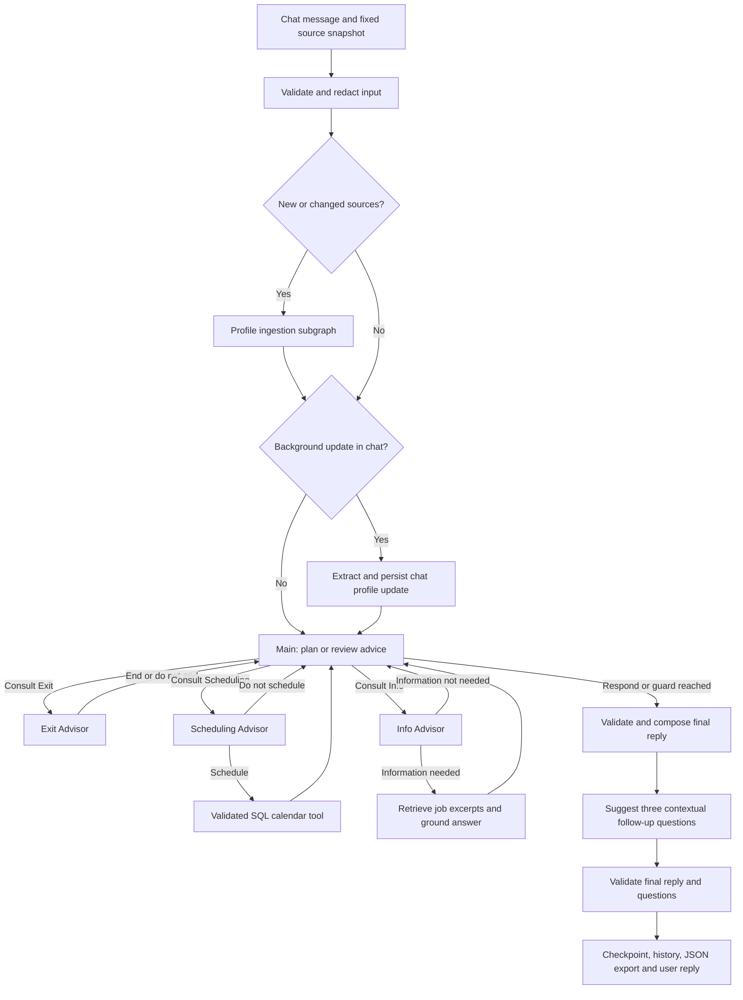

# Technion GenAI recruitment assistant

A Python Developer recruitment assistant for the Technion GenAI final project,
built with LangGraph, LangChain, OpenAI, PostgreSQL/pgvector, SQLAlchemy, and Streamlit. It gathers experience, answers
questions from job descriptions, offers recruiter availability, and records
confirmed interview bookings or ends the conversation politely.

The assignment is in [TASK.md](TASK.md). See the [license](LICENSE.md),
[security policy](SECURITY.md), and [contributors](CONTRIBUTORS.md).

## Status

The local application implements the Main/Advisor workflow, SQL booking tools,
PDF retrieval, incremental ingestion, daily synchronization, candidate profile
updates, guardrails, conversation JSON and token/latency traces. The corpus has
11 PDFs and 57 published chunks with 1,536-dimensional OpenAI embeddings. All
application and vector records share one PostgreSQL database with 22 tables.

The action evaluation was rerun after the fixes on 7 November 2026 using the
authorized redacted benchmark and its unchanged held-out split of three conversations.
The saved Exit predictions were rescored with failure-aware metrics without
additional Exit model calls:

| Evaluation | Correct / evaluated | Accuracy | Model/tool failures |
|---|---|---|---|
| Main workflow, all recruiter turns | 6 / 11 | 54.5% | 0 |
| Main workflow, candidate-response turns only | 3 / 8 | 37.5% | 0 |
| Prompted Exit Advisor, all recruiter turns | 11 / 11 | 100% | 0 |

These are exploratory results on a small sample. No verified historical calendar
or slot receipts were supplied; the evaluation uses an empty isolated calendar.
The executed [evaluation notebook](tests/test_evals.ipynb) contains the confusion
matrices, class metrics, majority baseline and disagreement IDs. Saved outputs
contain no conversation text. A separate live controlled replay passed all nine
turns across four fictitious cases, verifying persistent offers/bookings, mixed
questions, ambiguous acceptance and closure reasons with zero execution failures.
The automated suite passed 118 Python tests plus five browser-control checks.

Fine-tuning was attempted with `gpt-4.1-mini-2025-04-14`; OpenAI rejected creation
with HTTP 403, `training_not_available`. Both uploaded files were deleted. No
fine-tuned model or fine-tuned comparison is claimed. The prepared training estimate
was approximately $0.21 for three epochs, excluding evaluation calls.

Streamlit Community Cloud deployment is deferred at the user’s request. It still
needs GitHub sign-in and a hosted PostgreSQL/pgvector target. Local Docker
PostgreSQL is inaccessible from Community Cloud. The deployment section describes
the remaining setup; no cloud URL is claimed.

## Install and run

Clone the repository and enter its folder:

```bash
git clone https://github.com/sapir-pirski/technion-genai-recruitment-assistant.git
cd technion-genai-recruitment-assistant
```

Start Docker with Docker Compose and run commands from the repository root. The
default launcher builds and runs the app and PostgreSQL/pgvector in two containers.
Python 3.13, a virtual environment at `/opt/venv`, all Python dependencies and
LibreOffice are included in the application image; host Python is not required.

Copy the environment template, rename the copy to `.env`, and fill in your credentials:

```bash
cp -n .env.example .env
# Edit .env before continuing.
./run-full-project.sh
```

Both environment files contain exactly these three variables:

| Variable | Purpose |
|---|---|
| `OPENAI_API_KEY` | Your OpenAI API key, required for agents, embeddings, and model evaluation |
| `DATABASE_URL` | PostgreSQL connection URL used by every application component |
| `POSTGRES_PASSWORD` | Password for the bundled Docker database; use the same password in its connection URL |

Keep `.env` private and retain `.env.example` as the shared template. Both still
contain three credentials. Container startup translates the template's local
`127.0.0.1:55432` database endpoint to `postgres:5432` in the child process only;
it preserves credentials and does not rewrite `.env`. Hosted PostgreSQL URLs and
TLS options pass through unchanged; the launcher skips the bundled database for
hosted URLs.

The script reuses Docker's cached dependency layers, checks Python, required
packages, credentials and document support, waits for the database, checks PDF
index readiness, and starts or reuses the app. It opens your browser only after the
app is healthy. The default URL is **http://127.0.0.1:8502**. Existing PostgreSQL
data and credentials are preserved.

A fingerprint of image build inputs, host user/group IDs and the recorded image
identity avoids rebuilding/exporting unchanged images. Changed source or requirements,
or a replaced/missing image, triggers a build. The fingerprint cache lives under
`artifacts/launcher/` and contains no credentials or input documents.
If `.env` is missing, it copies the template with owner-only permissions and stops
so you can enter the three values. Dependency installation needs package-index
access; only new or changed PDFs need OpenAI embeddings and incur usage charges.

Containers keep running after the launcher exits. The launcher reuses this project's
published port, or selects a free port starting at 8502. `--port 8503` requests an
exact port and fails clearly if another process owns it; unrelated processes are
never stopped. `--no-browser` supports unattended use. Headless Linux prints the
URL when no desktop browser is available.
The launcher sets build-time user/group IDs to match the host, allowing the
non-root app user to write the mounted data folders without changing their permissions.

```bash
./run-full-project.sh --status
./run-full-project.sh --logs
./run-full-project.sh --restart --no-browser
./run-full-project.sh --stop       # Stop both services; retain database and files.
./run-full-project.sh              # Check/reuse dependencies, indexes and services; open browser.
```

`app` starts after the database health check and performs non-destructive schema
initialization with a bounded readiness wait before starting Streamlit. Container
restarts do not run ingestion or install dependencies. The launcher explicitly
runs `bootstrap --if-needed`: it compares PDF filenames/bytes, manifest hashes,
document paths, collection/format versions and published chunk completeness. Ready
indexes skip ingestion and model initialization entirely. New, changed, removed,
relocated or incomplete inputs use the existing incremental ingestion command.
No online source scraping occurs during startup. A subsequent `docker compose
up -d --wait` starts both services without re-ingestion; for hosted PostgreSQL,
use `docker compose up -d --no-deps --wait app`.

The application image contains code, dependencies and two explicitly included
fictitious evaluation fixtures. `.dockerignore` and explicit
COPY instructions exclude `.env`, deployment secrets, the host `.venv`, PDFs,
private datasets, configuration, reports and logs. Runtime bind mounts keep `data/`,
`config/` and `artifacts/` in the repository; the existing
`recruitment-project_postgres-data` volume retains SQL and vector data. Back up all
four together. Stopping or recreating containers preserves them; `docker compose
down -v` deletes the database volume and must not be used for normal shutdown.

All `python -m app.main ...` commands below can run in the built image by prefixing
them with `docker compose run --rm --no-deps -T app`, for example:

```bash
docker compose run --rm --no-deps -T app python -m app.main index-status
docker compose run --rm --no-deps -T app python -m app.main ingest
```

The database must already be running. Source refresh uses `sync-jobs`; `ingest`
reads only local PDFs. Images are built locally and are not published to a registry.

For startup problems, use `--status`, `--logs` and the owner-only
`artifacts/launcher/launcher.log`. Terminal errors identify the failed stage and log
path; configuration checks name missing credential variables without printing values.
Docker Desktop is started automatically on macOS when installed but inactive;
Linux attempts a rootless user Docker service. If that is unavailable, start the
daemon through the host's normal service management. Read-only lifecycle commands
do not start an inactive Docker daemon. Docker/Compose installation remains a host
prerequisite. A busy explicitly selected port needs another `--port`.
If Docker reports permission errors on mounted folders, rebuild through the
launcher as the folder-owning user so the image user IDs match. If authentication
fails after changing credentials, remember that editing `.env` does not change the
password already stored inside an existing PostgreSQL volume; update that database
password deliberately rather than deleting its volume. See the backup commands
below before moving or restoring a deployment.

### Native virtual environment

Use `./run-full-project.sh --native` for native operation on macOS/Linux/WSL. It
checks existing interpreters and reuses a compatible Python (3.11+, preferably
3.13). If none exists, it installs Python 3.13 using
[uv's managed Python support](https://docs.astral.sh/uv/guides/install-python/).
If uv itself is missing, its official HTTPS installer places it under
`artifacts/launcher/tools/`; managed Python stays under `artifacts/launcher/python/`.
No global Python, executable links or shell profiles are changed. Installation
needs network access. `PYTHON_BIN=python3.13` selects an existing interpreter.

The script creates `.venv` or preserves an incomplete/incompatible environment in
`artifacts/launcher/venv-backup-*` before rebuilding it. Missing pip is repaired
with `ensurepip`. An offline pip dry-run against `requirements.txt` and `pip check`
verify direct versions, extras and dependency consistency. Only failed checks
trigger package installation; healthy launches neither reinstall packages nor
contact a package index. Packages are installed only in the project venv.

Missing LibreOffice is installed using Homebrew on macOS or apt/dnf on supported
Linux systems. Homebrew must already be installed; Linux installation may require
the operating system's sudo prompt. Unsupported package managers receive a clear
setup instruction. Docker includes the converter and needs no host installation.

Native startup runs a managed background Streamlit process, waits for HTTP health,
and then opens the browser. Repeated starts reuse a healthy process; changed app
sources restart it. State and private logs live in `artifacts/launcher/`. Process
ownership is checked against its PID, start time and hashed command before signals
are sent, and native start/stop operations use a file lock. These commands work
without resetting database contents:

```bash
./run-full-project.sh --native --port 8503 --no-browser
./run-full-project.sh --native --status
./run-full-project.sh --native --logs
./run-full-project.sh --native --restart --no-browser
./run-full-project.sh --native --stop
```

Native stop affects only the managed app and leaves the shared database running.
`--server.port` remains an alias for `--port` in older commands. This flow starts
only the local PostgreSQL container, then runs the UI in the host venv.
Stop the containerized UI before switching runtimes; bootstrap refreshes local
document-path metadata without changing PDF bytes or re-embedding unchanged text.

Launcher checks cover mocked environment installation and dependency reuse,
credential preservation, startup/browser ordering and unrelated-process protection.
Live checks on
this machine verified Docker/native start, reuse, restart, stop, status/logs, browser
opening and skipped ingestion on ready indexes. Native checks reused the installed
Python and LibreOffice. Database records, all 11 PDFs, current vectors and `.env`
were unchanged, with zero new embedding calls. The ignored
launcher verification report (`artifacts/launcher/verification.json`, generated locally and Git ignored) records these checks.

For manual native setup:

```bash
python3.13 -m venv .venv
source .venv/bin/activate
python -m pip install -r requirements.txt
cp -n .env.example .env
# Edit .env with your credentials.
docker compose up -d --wait postgres
python -m app.main doctor
python -m app.main bootstrap
python -m streamlit run streamlit_app/streamlit_main.py --server.port 8503
```

On Windows, activate with `.venv\Scripts\activate`. Keep an existing `.env`
and edit it directly rather than replacing its values.

## Configuration and usage

Configure application behavior in the `Settings` class in
[app/config.py](app/config.py). Defaults are not repeated in the environment files.

| Setting | Default or behavior |
|---|---|
| `chat_model` | `gpt-4o-mini` for Main planning, cited job answers, scheduling tool calls and chat-profile revisions |
| `helper_model` | `gpt-5-nano` for Info classification, Exit classification, profile extraction and follow-up questions |
| `judge_model` | `gpt-4o-mini` for explicitly invoked offline quality evaluation |
| `exit_model` | Empty string uses the prompted helper-model baseline; set a supported returned model ID after fine-tuning |
| `embedding_model` / `embedding_dimensions` | `text-embedding-3-small` / `None` uses the model's default dimensions |
| `business_timezone` | `UTC` fallback when browser timezone detection is unavailable |
| `request_timeout` / `max_retries` | 30 seconds / 2 retries |
| `max_output_tokens` / `model_temperature` | 1500 / 0.0 for GPT-4o mini; operation-specific limits also apply |
| `job_data_path` | `data/`; PDF inputs are its `jobs/` child |
| `job_sources_path` / `job_manifest_path` | `config/job_sources.json` / `config/job_corpus_manifest.json` |
| `ingestion_report_path` | `artifacts/ingestion/` |
| `conversation_export_path` / `log_level` | `artifacts/conversations.json` / `INFO` |
| `dataset_version` | `assignment-v1`; verified benchmark version read from PostgreSQL |
| `max_advisor_consultations` | 3 advisor visits per user turn; bounds the Main/Advisor loop |
| `corpus_limit` | 10 selected online postings; manually added PDFs are not limited by this setting |
| `chunk_size` / `chunk_overlap` / `pipeline_version` | 900 / 120 characters / `jobs-v1` |

Restart the app or notebook kernel after changing configuration. Model access
depends on your account. Chat, retrieval queries, document embeddings, evaluation,
and explicitly submitted fine-tuning jobs can incur API usage charges.

`Settings.model_policy()` is the single operation-to-model policy. Main planning,
Info answers, Scheduling and chat-profile revisions use GPT-4o mini. The independent
Info decision, Exit, source fact extraction and three-question generation use GPT-5
nano. Live chat-revision checks found nano could exhaust the 1,500-token completion
budget; that structured operation uses the existing non-reasoning chat model. Nano uses
`reasoning_effort="low"` for classification and profile extraction, and
`"minimal"` for follow-ups, and omits temperature. Live checks found that minimal
effort could incorrectly decline a clear role question or paraphrase profile
excerpts, so those actions use low effort. All requests use
`max_completion_tokens`: Exit and Info decisions are capped at 512, follow-ups at
768, and planning, answers, scheduling and profile extraction at 1,500; lowering
`max_output_tokens` lowers these caps too. Completion limits include reasoning
tokens. Changing model families requires checking their supported parameters.
There is no automatic escalation to a more expensive model. API failures retain
the existing error/retry behavior; invalid follow-ups retain their local fallback.
The Main/advisor loop, SQL tool validation, explicit booking confirmation and
source-grounding checks remain in force. Final reply assembly is Python code.

Prompts live in `app/prompts/`, with one file per task. GPT-4o mini receives system
instructions with explicit decision rules, field meanings and targeted examples.
GPT-5 nano receives developer instructions with concise goals and constraints;
it is not asked to reveal reasoning. Context JSON or profile text is sent in a
separate user message. Examples are independently authored and do not use the
stored benchmark. This follows OpenAI's
[prompt guidance](https://developers.openai.com/api/docs/guides/prompt-engineering)
and [reasoning guidance](https://developers.openai.com/api/docs/guides/reasoning-best-practices).

| Prompt | Default model | Purpose and important rules |
|---|---|---|
| `main.txt` | GPT-4o mini | Main's routing priorities, first advisor consultation, mixed requests, profile corrections and bounded follow-up consultations |
| `scheduling.txt` | GPT-4o mini | One calendar call when needed; no invented date preferences, AM/PM or acceptance; SQL remains authoritative |
| `info.txt` | GPT-4o mini | Under-100-word answers grounded in supplied excerpts; partially covered answers cite supported facts and identify missing details |
| `info_decision.txt` | GPT-5 nano | Outstanding candidate questions versus experience-only, calendar-only or already handled requests |
| `exit.txt` | GPT-5 nano | Exactly `end`/`do_not_end`, including slot rejection, negated disinterest and unanswered questions; no claim that history verifies a booking |
| `profile.txt` | GPT-5 nano | Verbatim source fact extraction, null/empty missing fields, no inferred durations or paraphrasing |
| `chat_profile.txt` | GPT-4o mini | Grounded latest-message facts and exact known fact IDs for explicit corrections or confirmations |
| `followups.txt` | GPT-5 nano | Exactly three candidate questions, related details when available and clarification when information is missing |
| `judge.txt` | GPT-4o mini | Offline answer-quality rubric, evidence references, unassessable ratings and brief reasons |

The backend snapshots prompt text when it is created. Each model-call span stores
`prompt_name`, `prompt_sha256` and `instruction_role` in its existing JSONB
attributes, never the prompt or candidate text. Evaluation reports contain a
`prompt_manifest` with the same identifiers per operation. Restart the app or
notebook kernel after a prompt edit so the new prompt and hash load together.
The profile cache includes the extraction prompt hash and instruction role.

The CLI doctor, evaluation reports and evaluation notebook display the complete
model policy. Changing only the chat model does not invalidate extracted candidate
profiles; their identity includes the extraction model, parameters and prompt.
Unchanged source facts are reused. Switching chat/helper models does not change
the embedding identity or require re-embedding PDFs.

Standard USD prices per million text tokens, checked on 7 November 2026:

| Model | Uncached input | Cached input | Output |
|---|---:|---:|---:|
| `gpt-4o-mini` | $0.15 | $0.075 | $0.60 |
| `gpt-5-nano` | $0.05 | $0.005 | $0.40 |
| `text-embedding-3-small` | $0.02 | — | — |

See [OpenAI pricing](https://developers.openai.com/api/docs/pricing). These rates
are not a promise of savings: reasoning, context, retries and actual model quality
affect cost per successful conversation. The dated estimator covers Standard text
requests only, excluding special processing tiers and discounts.

This is a short-term assignment configuration. OpenAI lists **11 December 2026**
as GPT-5 nano's shutdown date and **14 January 2027** for GPT-4o mini. Replace and
evaluate these models before those dates; do not silently switch a running app.
See the [official deprecations](https://developers.openai.com/api/docs/deprecations).
GPT-5 nano is the prompted Exit baseline, not a fine-tuned model: the assignment's
fine-tuning requirement remains outstanding until an eligible account completes
training. New fine-tuning access is restricted; see
[fine-tuning availability](https://developers.openai.com/api/docs/guides/supervised-fine-tuning).

Choose a position in the compact header and type directly into the message box, or
use a suggested question. There is no separate start screen. Try:

- “I have four years of Python experience.”
- “What skills does this role require?”
- “Do you have anything next Friday morning?”
- “Please stop texting me.”

The chat has a compact role header with a **Change role** popover instead of a
second full-width title row. The popover keeps full searchable job names, companies
and locations; it locks once a conversation starts. **About this role** opens an
accessible reading dialog with the complete stored description and original posting.
Escape, the close icon or **Close description** dismisses it and returns focus.
Descriptions use the source wording without AI rewriting or a
character limit. Collection preserves headings, emphasis, links, numbered steps,
and nested bullet lists as canonical Markdown. The UI renders that structure
with raw HTML and embedded images disabled; it does not guess bullets from
paragraphs. The reading column is limited to 75 characters in width, with natural
word wrapping; the dialog scrolls through the complete text without truncation.
Ingestion retains the full description of local PDFs in `data/jobs/` and the
full collected description for imported postings. Redundant opening document
titles, breadcrumbs, standalone application controls, and exact repeated
introductions are removed from the presentation. Meaningful application steps,
contact information, requirements and disclosures remain. Metadata labels and
their values share a line. Opening the dialog reads the last completely indexed
presentation from PostgreSQL without model calls. The original role is displayed
as **Python Developer** without an invented employer name. Imported roles show
their actual employer.

Job options show **Job title · Company · Location**, with the published
workplace type when available. The selected role repeats these details below
the company name with a small location icon. Multiple locations are retained;
Remote, Hybrid and On-site appear only when stated by the source. Regional
restrictions such as **Remote / Berlin, Germany** remain intact, and a mode
already included in the location is not repeated. Missing or placeholder
locations produce no label or empty icon. The assignment PDF, IFON PDF and
Rathin posting do not specify a job location, so their location stays blank.
Long dropdown options wrap on narrow screens so their locations remain readable.

The UI reads the `jobs.locations` JSONB array and `jobs.workplace_type` fields in
PostgreSQL. ATS feeds supply these during collection; reviewed employer sources
use the explicit `locations` and `workplace_type` metadata in
`config/job_sources.json`. The normal scheduled sync saves that metadata and
the corpus manifest, so restored catalogs retain it too. Review and update
the pinned source metadata when an employer changes these details. The browser
timezone is used for interview times and does not determine a job's location.

The header actions appear in order: **Download PDF**, **Print**, **Record**.
The PDF icon downloads the currently selected job's PDF while the description
dialog is closed. It preserves the filename and downloads directly
without rerunning the conversation. It uses the same outlined SVG, 44 px
button, teal hover state and dark tooltip below the icon as Print and Record.
Its tooltip and screen-reader label are **Download job description (PDF)**.
If a job has several PDFs, each has a download icon with its filename in the
label. Unavailable PDFs have a disabled control with an explanatory tooltip.

A 48 px company logo aligns with the top of the job title. The company name
stays below the title in the same text column, including when a long title
wraps. A missing logo renders no
icon, initials, placeholder frame, or reserved space; the title uses the freed
width. Selecting another job changes the logo with its title.

The app uses one warm light theme, configured in `.streamlit/config.toml` and the
shared color variables in `streamlit_app/styles.css`. Streamlit hides the
System/Light/Dark choices from its menu. The custom header controls inherit the
same variables as the chat; no theme selector is exposed to candidates.

| Role | Color |
|---|---|
| Page background | Warm off-white `#F7F7F3` |
| Cards and assistant messages | White `#FFFFFF` |
| Input backgrounds | Light neutral `#EEF1EC` |
| Main / secondary text | Charcoal `#202722` / muted gray-green `#58635C` |
| Primary / hover | Deep teal `#21685B` / dark teal `#194E45` |
| Candidate messages and selected fills | Pale sage `#E6F0EB` |
| Decorative borders / control outlines | `#D8DED7` / `#7C8980` |

Send and confirmation actions use teal, while question buttons stay white with a
subtle sage hover. Selected tabs retain their underline, and keyboard focus has a
solid teal outline. Placeholders use the secondary text color. Success messages
use green, warnings amber, and errors and active recording use red, with their
existing text and icons. Company logos retain their source colors.

The specified palette pairs provide contrast of 6.57:1 for white on teal,
6.26:1 for secondary text on white, 5.49:1 for secondary text on input backgrounds,
and at least 3.21:1 for control outlines against their adjacent input fill.
These are color-pair calculations, rather than a full accessibility certification.

The outlined Print and Record icons replace the Print/Record screen dropdown.
**Print** opens the browser print dialog. **Record screen** opens the browser's
sharing picker; after you choose a surface, it changes to a red **Stop recording**
icon. Stopping from the icon or browser sharing controls downloads the video
locally (WebM or MP4, depending on browser support). A download link is available
if the browser blocks the automatic download. Recording captures video only;
it uses no microphone, and videos never go to the app server or database.
Screen recording requires a supported desktop browser and HTTPS or localhost.
The buttons show compact dark tooltips below the icons after a 200 ms hover or
keyboard-focus delay: **Download job description (PDF)**, **Print conversation**, **Record screen**, or **Stop
recording** while active. Tooltips dismiss when the pointer/focus leaves or Escape
is pressed. Keyboard focus styles and accessible labels are included.

Expand **Introduce yourself** for **Introduction · LinkedIn · Upload file**.
Small person, LinkedIn and upload icons appear before the labels and follow the
selected tab's teal highlight.
The panels share a compact minimum height and top alignment, with reduced bottom
spacing, and grow naturally when document details need more room.
All tabs provide background context: type an introduction, add a LinkedIn reference,
and/or attach a PDF, DOC, DOCX or TXT document. There are no separate send,
read or review buttons. Send your first chat message, or choose a suggested
question, and the assistant automatically processes every populated tab before
responding. Merely opening the page, typing or switching tabs makes no model call.
The panel stays available during an active conversation; later changes are read
with the next message. **New conversation** clears these inputs.

Inputs are ordinary Streamlit widgets, so changes reach session state without a
form submission. Each message captures all tab values, including inactive tabs,
into one fixed request snapshot. Retries reuse that snapshot. Pending requests
lock inputs; a UI rerun does not submit another request. Actual sent messages
remain the conversation turns; extracted profile text is separate context.

LinkedIn URLs are references only; the app does not fetch profiles or use browser
cookies. The LinkedIn tab contains only **LinkedIn reference URL**, with a tooltip
explaining this limitation. Local syntax validation shows malformed links beside
the field without fetching a page or calling a model. It does not verify existence,
accessibility or ownership. Use Introduction or Upload file to supply profile information.
A URL alone is saved as a reference and the chat continues normally. Broader Profile API access requires approval
([LinkedIn Profile API](https://learn.microsoft.com/en-us/linkedin/shared/integrations/people/profile-api)).

Uploads are limited to 5 MB, with at most 10 PDF pages and 24,000 extracted
characters per source. The native upload button shows only its upload icon, with
an **Upload CV or profile** tooltip on hover or keyboard focus. Its accessible
**Upload CV or profile** label, file picker, allowed-format/size text and validation
remain available. The tooltip is hoverable, stays visible as the pointer moves onto
it, and dismisses with Escape without moving keyboard focus.
The introduction box accepts 4,000 characters. PDF reading
uses PyMuPDF; DOCX reading uses python-docx and includes paragraph/table text;
TXT supports UTF-8 (including BOM) and UTF-16 with BOM. Legacy DOC uses LibreOffice
headless conversion in a private temporary directory, with macros disabled and
a 30-second conversion timeout. Install LibreOffice locally before startup:

```bash
# macOS
brew install --cask libreoffice
# Ubuntu/Debian
sudo apt-get install libreoffice-writer
```

`run-full-project.sh` checks the converter after Python dependency installation;
`doctor` reports `document_converter_ready`. Streamlit Community Cloud installs
`libreoffice-writer` through the root `packages.txt`. Password protected, scanned,
corrupt, oversized or unsupported documents produce a source-specific message.
OCR is not automatic. Valid sources and the actual chat request still proceed.
Document-reading errors appear beside the current upload, and introduction errors
beside that text area. The panel opens for matching source failures. Content hashes
and filenames prevent an error from a replaced file appearing on the new file;
document parsing and model extraction still happen with a real message.

The `profile_ingestion` LangGraph subgraph validates sources, reads documents,
extracts verbatim facts, merges them, and publishes a versioned candidate profile.
Each fact must match its source text. Exact repeated facts merge while retaining
all supporting source IDs. Different names and conflicting explicit numeric
Python-experience claims are flagged for clarification. Career duration is never
converted into Python experience. The separate `chat_profile` subgraph runs for
relevant background statements before Main: `extract_chat_update` then `persist_chat_update`. It extracts only
facts whose words match the durable latest user message and reads the preceding
assistant question to interpret short replies. An added terminal sentence stop can
be removed when the retained excerpt matches the source; no words are repaired or
invented. Main receives active profile
sections, conflicts, missing details and verification status.

A differing claim preserves both versions and prompts clarification. Only an
explicit correction with a grounded replacement can supersede a known fact.
Unsupported model-proposed facts and revisions are ignored independently, so valid
new facts or confirmations can still be kept. Rejection counts are traced without
logging the rejected text.
Each claim retains its stable fact ID, source or actual chat message/request IDs,
active/superseded status and self-reported/confirmed-by-candidate status. An explicit
confirmation references the particular supported claim; ambiguous yes replies cannot
choose between conflicts. Confirmation records what the candidate affirmed and does
not verify credentials externally. Superseded evidence stays in the audit history.

Chat updates and verification are JSON inside the existing `candidate_profiles.data`
column; no new tables or migration scripts are needed. Later source changes preserve
chat updates. Checkpointing extraction before publication lets a failed profile write
resume without repeating a completed model call. A chat-extraction failure is traced
and leaves the prior profile intact; the candidate can restate the information.
The obsolete generated experience-summary field has been removed. Profile content
is untrusted background data and cannot request scheduling, alter tools, or establish
job requirements.
Only Main receives the derived candidate profile. Calendar and information-decision
model requests use actual conversation history and their task context without
copying background documents into those advisors' prompts.

Content hashes scoped to the conversation and the parser/model/prompt version
reuse completed extraction. Each new or changed nonempty text/document source
can make one extraction call; SDK retries are bounded by the existing retry setting.
Transient extraction failures can be attempted again on later turns, up to three
logical source attempts. Invalid documents and unsupported extraction results are
terminal until the candidate replaces or edits that source. Explicit opt-outs skip
source capture and extraction. An empty background behaves like ordinary chat.

The first message and source IDs are saved atomically before graph execution.
Pending upload bytes live temporarily in PostgreSQL for recovery, then are cleared
after successful text extraction or terminal failure. Extracted text, source
hashes, facts, errors and profile versions remain in PostgreSQL until explicitly
removed. No candidate files are added to `data/jobs/`. Graph checkpoints contain
source references and the compact derived profile, rather than uploaded bytes or
full document text. The subgraph inherits the parent PostgreSQL checkpointer;
synchronous checkpoint writes and idempotent source/profile writes allow a worker
to resume the same thread/request. A provider call interrupted before its result
is durably recorded can still be repeated. Candidate profiles never enter job RAG.

The timezone is automatically detected through Streamlit's browser context for
each new conversation, with `business_timezone` as a fallback when detection is
unavailable. There is no manual timezone selector. The position dropdown is inside
**Change role**, with its label available to screen readers. A small **Times shown
in …** label appears beside available interviews.
Appointment review and confirmation also include the timezone. Position and
timezone stay fixed during a conversation so retries and bookings remain consistent.
**New conversation** starts a fresh thread and clears the form; it preserves
recorded messages and confirmed bookings.

Available interview times appear inside the latest assistant message as up to
three cards showing the full date,
start/end time and duration when known, IANA timezone, and the appointment's UTC
offset. **Choose time** opens a review without booking. **Confirm interview** sends
the existing validated calendar request; confirmation appears only after a SQL
booking receipt. You can also accept an offered appointment explicitly in chat.
If a slot is no longer available, the service asks for another time. Calendar
invitations are not sent by this app.
The cards replace only the exact generated availability list associated with that
answer's receipt. A confirmed receipt also presents its date once. PostgreSQL,
JSON exports and CLI responses retain the full original text. Older transcript
messages keep their text and do not expose stale booking buttons.

Factual answers show a compact **Source · page …** reference and retain their own
**Sources** expander with readable PDF names
and page numbers, resolved from the cited chunks for that job without another
embedding or model request. If earlier chunks have been retired, the UI says
their details are unavailable and offers the current description above. Raw
chunk IDs and execution traces are kept out of the candidate view.

Pending submissions disable further input. On a request failure, the submitted
information remains available and **Retry request** reuses its original request
ID, preventing duplicate bookings. Opening job details or changing other display
controls never silently retries a failed request.

Pending replies appear as an assistant bubble with real progress labels for source
reading, job-information lookup and interview availability. After Main composes the
verified reply, the UI can display that answer while follow-up generation finishes.
The graph still publishes one complete answer/suggestion receipt and transcript
turn. Interrupted display callbacks are logged safely without undoing a booking or
rerunning model work; retries use the existing request ID and checkpoints. An
interrupted browser request retains its submitted information and composed answer.

Each new conversation starts with the same three clickable questions, for every job:

- **What skills are required for this role?**
- **What are the main responsibilities?**
- **How can I arrange an interview?**

The starting questions appear in the chat composer, directly above the message input.
Before the first message, this composer sits directly below **Introduce yourself**.
Once the conversation starts, the input stays pinned to the bottom of the window.
Displaying the questions does not create a conversation turn or call a model.
Clicking a question sends its exact text as a normal candidate message and includes the current introduction,
LinkedIn reference and uploaded document snapshot. For reference postings, interview
questions still go through the existing employer-only scheduling rules.

After an active assistant answer, three short contextual questions appear inside
the latest assistant message, beneath its answer. They are questions the candidate
can ask, based on the selected job, recent dialogue, latest response and appointment state. Suggestions are hidden
while a request is pending and after the conversation closes. Earlier answers retain
their saved suggestions in PostgreSQL and exports, but only the latest answer's
questions are shown as buttons. Rerendering never generates new suggestions.
Question buttons use consistent wrapping and stretch to share the row. At narrow
widths they and appointment cards stack vertically, retaining full labels and
44-pixel button targets. Header controls also wrap below the title.

The frontend preserves the reading position when the candidate scrolls away from
the latest answer. A new reply brings its beginning into view only when following
the conversation; long replies are not continuously scrolled to their end. **Latest
message** offers a jump when the latest answer is outside the visible reading area.
The composer uses browser visual-viewport information for keyboard clearance and
reserves scroll space for the pinned input. This behavior and upload tooltip events
are frontend-only; they send no document text or events to another service.

Imported postings answer job questions and link to their source. Their recruiter
calendars are not connected. Booking requires authorized availability in PostgreSQL
and scheduling enabled for the selected job; startup never generates appointments.
For a terminal conversation, run `python -m app.main chat`.

The assignment role has 160 user-approved, 30-minute appointments for
**4–17 November 2026**, Sunday–Thursday, **09:00–17:00 Asia/Jerusalem**. SQL stores
their UTC start times and duration; the UI displays the selected timezone. The
last start each day is 16:30 local time. The existing historical booking is retained.
This finite calendar is not extended automatically; future availability requires
new recruiter-approved dates. Imported postings do not share these slots.

Calendar management uses the same two tables, `interview_slots` and
`interview_bookings`. Operators with database credentials can inspect remaining
availability and its expiration:

```bash
python -m app.main calendar status \
  --job-id assignment-python-developer --timezone Asia/Jerusalem
```

The JSON output includes `status` (`available`, `fully_booked`, `expired`, `empty`
or `disabled`), `future_available`, `past_unbooked`, `bookings_total`,
`last_configured_date`, `days_until_last_date`, the last appointment and the next
three available slots. Past rows are retained for history and excluded from offers.

To validate an additional date range, supply recruiter-approved dates, working
weekdays, local hours, timezone and duration explicitly. The following dates are
an example proposal and have **not** been added to the configured calendar:

```bash
python -m app.main calendar add \
  --job-id assignment-python-developer \
  --from-date 2026-11-18 --to-date 2026-12-01 \
  --weekdays sun mon tue wed thu \
  --start-time 09:00 --end-time 17:00 \
  --timezone Asia/Jerusalem --duration-minutes 30 --dry-run
```

`--dry-run` validates the complete request without changing appointments; technical
traces are still recorded. To add an approved range, run the command with the
approved arguments and omit `--dry-run`. Ranges are inclusive and limited to 366
days and 10,000 appointments per command; durations are 1–480 minutes. Hours must
stay within one local day and divide evenly into complete appointments. Ambiguous,
nonexistent or duration-changing daylight-saving times require different hours.
Every appointment must start in the future. An invalid request, duplicate or
overlapping appointment rejects the entire addition. Per-job database locking
serializes concurrent calendar additions. Existing appointments, including booked
or unavailable ones, remain intact. Future legacy slots without durations must be
resolved before overlap validation can proceed. The selected job must be active
with scheduling enabled; calendar management does not enable imported jobs.

For Docker, prefix either command with
`docker compose run --rm --no-deps -T app`, for example:

```bash
docker compose run --rm --no-deps -T app python -m app.main calendar status \
  --job-id assignment-python-developer --timezone Asia/Jerusalem
```

These commands use PostgreSQL without calling OpenAI. Run the project launcher
first to initialize storage. Calendar operations use existing application modules;
no new tables, environment variables or migration commands are needed.

Availability searches apply job, date, local-time, morning/afternoon and declined
slot filters in SQL before limiting results. With no date preference, the next
three future appointments can be found beyond 30 days. If a requested date/time
has no match, the tool offers up to three future alternatives nearest the requested
instant, clearly labeled as alternatives and displayed chronologically. A date
without a time uses that date's local midnight as the ranking anchor. Alternative
times can differ from the original preferences and need their own confirmation.
If an offered appointment is taken before confirmation, the tool refreshes
alternatives immediately and excludes the failed choice and declined slots. It
never books a replacement automatically. An exhausted calendar reports that a
recruiter needs to add availability. These lookups remain inside the existing
calendar tool and Scheduling Advisor node; they add no model calls.

Scheduling, conversation and CLI tests cover the calendar update. Live container checks verified
status, an addition with `--dry-run`, and alternative lookup with an empty OpenAI
key. All 161 stored slots, the existing booking, other application records, input
PDFs and credentials were preserved; the schema remains at 22 tables. The local
verification report is `artifacts/calendar-verification.json` (Git ignored).

## Architecture and booking behavior

The Main Agent coordinates three advisors through LangGraph:



Main chooses one advisor at a time and reviews its result before choosing another
advisor or replying. There is no mandatory advisor order. Each advisor receives
bounded recent candidate/recruiter history; the full transcript stays in PostgreSQL.
Advisor outputs stay in internal state;
only the final Main reply is added to the transcript.

Exit returns `end/do_not_end`; Scheduling returns `schedule/do_not_schedule`;
Info returns `info_needed/info_not_needed`. The latter two decisions gate calendar
availability searches and vector retrieval. Main retains the original user intents
when reviewing results so mixed information/booking requests are handled together.
A helper’s negative Info classification cannot erase a new explicit candidate
question already identified by Main; that question is preserved for source-grounded
retrieval. Only SQL receipts establish a confirmed booking. Main supplies a closure intent:
`opt_out` for actual disinterest, `scheduled` for a completed booked exchange, or
null. A binary Exit `end` label cannot close a scheduling exchange on its own.
The final result records `closure_reason` as `opt_out` or `scheduled`; the latter
requires a matching SQL receipt. Ambiguous closure stays active for clarification.

The default limit is three consultations, configured in `app/config.py`. Repeating
the same advisor task with unchanged inputs is blocked. Before stopping, Main
routes any remaining known request to its unconsulted advisor within the budget.
The routing history records `rerouted_from`. Counts and results reset
for each user turn. Main handles errors and exhausted budgets with verified partial
results or a clarification response. `routing_history`, decision codes, and stop
reasons are traced without raw prompts or internal reasoning text. The limit counts
advisor visits; planning, decision checks, and grounded-answer model calls have
their own usage spans. Actions (`continue`, `schedule`, `end`), booking state,
and conversation state are separate.

The `suggest_followups` node runs after `compose`, outside the advisor loop, followed
by the final `output_guard` check.
Its structured model call has no tools and cannot alter the composed answer, profile,
booking, action or conversation status. It receives job metadata, the last 12 messages
(up to 2,000 characters each), the latest answer (up to 6,000 characters), the last 30
suggestions and booking/availability flags. Full profile documents and extracted text
are not included. Its call is traced separately and uses the configured helper model,
timeout and bounded SDK retries; it adds one model operation to an active successful
turn. Closed conversations and action evaluation skip generation. Failed answers use
fallback questions without making another suggestion-model call.

Output validation requires exactly three distinct, single-line questions, each
10–140 characters and ending in one question mark, without links or markup.
The prompt directs at least two questions to build on details in the latest answer.
Exact matches to candidate
messages and the last 30 offered suggestions are rejected after punctuation/case
normalization. The prompt also asks the model to avoid already answered topics and
semantic repetition; that semantic check is model-based, rather than a guarantee.
Invalid output or provider failure uses three capability-aware fallback questions
without failing the answer. Fallbacks favor fresh questions about the current topic,
offered dates, interview preparation or employer next steps. If a prolonged outage
exhausts that finite pool, older fallback questions may be reused.

Suggestion IDs are derived from the conversation, answer request and question text.
The answer and its questions share the durable response receipt. An interruption
after composition resumes at the pending suggestion node, without rerunning advisors
or booking tools. A provider call interrupted before checkpointing can still repeat;
completed requests and refreshes reuse the saved questions. A different request cannot
overtake an unfinished one.

- Calendar tools accept validated arguments; models cannot execute arbitrary SQL.
- Offer up to three chronological appointments for the selected job and position,
  excluding declined slots. Search newly proposed dates before previously offered times.
- Book only an explicitly accepted slot already offered in that conversation.
  Conditional updates and uniqueness constraints prevent double booking; repeated
  requests return the existing receipt.
- Opt-outs suppress scheduling. Booking can conclude with `end`; booking alongside
  a job question can remain `continue`.
- Store times in UTC and display the selected timezone. Resolve relative dates from
  the incoming message timestamp, including historical timestamps in evaluation.
- “Next Friday” means Friday of the following ISO week; “Friday” or “this Friday”
  means the next occurrence, including today. Clarify ambiguous numeric dates,
  missing AM/PM, and nonexistent or repeated daylight-saving times.
- Supported date inputs include ISO dates, full English dates, weekdays, today,
  and tomorrow. Other phrases need an exact date. Show the absolute date before booking.

The Info Advisor retrieves only the selected job's complete published document
versions and cites excerpt IDs internally. Unsupported facts receive a “not
specified” answer; earlier recruiter messages are not authoritative job facts.

LangGraph checkpoints persist opaque conversation UUIDs in PostgreSQL. A restored
UUID can resume after a process restart, but browser refresh may create a new
Streamlit session. Authentication, cross-device recovery, calendar invitations,
cancellation, and rescheduling are not implemented.

## Runtime guardrails

`app/guardrails.py` supplies shared checks at graph entry, model input, retrieval,
calendar booking and final output. These checks in code add no model calls,
dependencies, environment variables or database tables. They preserve the Main
Agent and its three advisors, Continue/Schedule/End decisions, SQL scheduling and
offline embedding required by the assignment. The quality judge remains offline.

| Boundary | Enforcement |
|---|---|
| Input | Candidate/assistant dialogue roles only; chat messages remain limited to 4,000 characters. Recognizable credentials are redacted before new chat/plaintext background is stored and processed. |
| Profile documents | Existing format, byte, page and extracted-text limits remain. Credential patterns are redacted after reading a document and before saving extracted text or requesting profile facts. Temporary original upload bytes are cleared after extraction; they may briefly exist in PostgreSQL while processing is pending. |
| Model context | Send at most the latest 12 messages within a 16,000-character history budget. Reject complete user payloads over 48,000 characters instead of silently cutting profile facts or evidence. These are character bounds, not exact token counts. Fixed prompts and output tokens have separate limits. |
| Retrieved evidence | Reject explicitly mismatched job IDs and supported answers with missing or unknown source IDs. Track retrieved IDs per turn so final citations can be checked again. |
| Calendar write | Require a previously offered slot and verify acceptance against the current candidate message or trusted UI selection before calling the SQL booking transaction. Model acceptance flags alone cannot authorize a booking. |
| Reply | Compare booking data with a fresh SQL receipt, validate action/status consistency and source IDs, bound reply length, redact recognizable credentials and reject detected confirmation claims outside the receipt-derived text. |
| Follow-up questions | Retain the three-question schema and repetition checks; reject recognized booking/cancellation commands and requests for credentials or sensitive identifiers. Use existing local fallbacks without another model call. |

Recognized credential patterns include sufficiently long `sk-…` tokens, AWS access
key IDs, GitHub token prefixes, bearer tokens, private-key blocks, explicit
`api_key`/`password`/`client_secret` assignments and connection URLs containing
passwords. Names, contact details and relevant candidate experience are preserved.
Recognition is deliberately limited: unfamiliar credentials and semantic leaks can
be missed. Existing historical rows, original job PDFs and prior exports are not
retroactively rewritten. Quality packets containing detected credentials are
rejected before the judge call so their evidence is not silently changed.

The graph starts with `input_guard`, before optional profile ingestion and Main.
Composition validates its response before returning any `answer_ready` event;
`output_guard` checks the final result after suggestions and before the durable
conversation receipt and JSON export. Intermediate graph checkpoints still support
recovery. Main/advisor results are scrubbed for recognizable credentials before
checkpointing. No unchecked assistant text is displayed by the early-answer callback.
An inconsistent reply becomes a controlled clarification. If SQL already recorded
a booking, the fallback preserves and reports that real receipt without rebooking.

Booking consent uses a conservative English grammar. For example, “I accept the
first appointment” resolves the first offered slot; “I accept 10:00” must match one
offered time and the actual date/time phrase in the message. A bare “yes” cannot
select between several offered slots. Quoted text, negation, uncertain wording or
an unverified selector produces clarification; the Confirm interview UI remains
available. Documents and advisor assertions cannot supply consent. A Main Agent
stop flag alone also cannot close a conversation: an actual opt-out or Exit
Advisor decision based on dialogue is required.

Each check uses existing `trace_spans` with `component=guardrail`. JSONB attributes
and structured JSON log events contain `rule_id`, `stage`, `outcome`
(`allow`, `clarify`, `redact` or `block`) and `reason_code`; spans supply duration,
trace/request/conversation IDs. They do not contain rejected text or credentials.
For example:

```json
{"rule_id":"booking_consent","stage":"tool","outcome":"clarify","reason_code":"acceptance_not_verified"}
```

These controls enforce specific invariants, not complete prompt-injection detection
or semantic factuality. A real citation can still accompany an unsupported claim;
prompts and the offline judge support review of those cases. Pattern checks can
also need clarification for legitimate wording. Adversarial tests use fictitious
inputs and mocked models to cover injection through profiles, unauthorized SQL
writes, fabricated receipts/citations, credential redaction before display/export,
unsafe suggestions and legitimate mixed information/booking requests.

Guardrail checks run with Ruff lint/format validation, isolated PostgreSQL
databases and mocked models; no
stored private conversations were sent to OpenAI for this verification. Retry
recovery also reuses the redacted message without repeating completed model work.

## Database and schema

One PostgreSQL database with pgvector stores catalog records, embeddings, bookings,
conversation history, execution traces, and LangGraph checkpoints. All components use the same `DATABASE_URL`.
[compose.yaml](compose.yaml) starts the database and app containers. Native and
Streamlit Community Cloud operation use the same application code and database schema.

The local service binds to `127.0.0.1:55432` and retains data in
`recruitment-project_postgres-data`. `docker compose stop` preserves it;
`docker compose up -d --wait` starts it again. Initialization creates the vector
extension and final tables when absent, under an advisory lock, without resetting data.

The initialized application has **22 tables**: 18 application tables below and
four managed by LangGraph. Catalog/calendar models are in [app/ingestion/models.py](app/ingestion/models.py)
and [app/storage/models.py](app/storage/models.py); vectors are defined in
[app/rag/models.py](app/rag/models.py).

| Table | Main columns and purpose |
|---|---|
| `companies` | `company_id` PK, unique `identity_key`, `name`, `website_url`, `logo_source_url`, PNG `logo_data` BYTEA, `logo_mime_type`, `logo_sha256`, `logo_pipeline_version`, `logo_etag`, `logo_last_modified`, `logo_checked_at`, `logo_updated_at`, `logo_status`, nullable `logo_error_code` |
| `job_sources` | `source_id` PK, `provider`, `board_identifier`, nullable `company_id` FK, `company_name`, `enabled`, `last_successful_sync_at` |
| `jobs` | `job_id` PK, `source_id` FK, nullable `company_id` FK, `external_job_id`, `canonical_url`, `company_name`, `title`, `description_text`, `description_format` (`plain` or `markdown`), `employment_type`, `seniority`, `workplace_type`, `compensation`, `locations` JSONB array, `status`, source timestamps, `first_seen_at`, `last_seen_at`, `closed_at`, `missing_scans`, `scheduling_enabled` |
| `job_documents` | `document_id` PK, `job_id` FK, `source_path`, `source_url`, `enabled` |
| `document_versions` | `document_version_id` PK, `document_id` FK, PDF path and PDF/text SHA-256 hashes, `pdf_data` BYTEA, `presentation` JSONB (canonical text/format, public job metadata, source notes, format version), pipeline/model/dimensions, collection, expected/indexed chunk counts, status, indexing time, error code, `is_active` publication flag |
| `ingestion_runs` | `run_id` PK, trigger, start/end timestamps, status, aggregate counts, `items` JSONB array of processing outcomes |
| `sync_leases` | Lease ID, owner, expiration; prevents overlapping corpus writers |
| `interview_slots` | Slot ID, job ID, UTC start, position, availability, nullable positive `duration_minutes` (unknown for historical records) |
| `interview_bookings` | Booking ID, job ID, slot FK, conversation ID, request ID, creation time |
| `rag_collections` | Collection ID PK, embedding model, vector dimensions |
| `rag_chunks` | Composite PK `(collection_id, chunk_id)`, job/document/version FKs, text, embedding, dimensions, JSONB metadata |
| `conversations` | `conversation_id` PK, `job_id` FK, `status`, `timezone`, timezone-aware `started_at` / nullable `ended_at` |
| `conversation_messages` | `message_id` PK, conversation FK, `sequence_no`, `request_id`, `role`, `content`, `occurred_at`, nullable `predicted_action`, `response_data` JSONB receipt (assistant result/suggestions, candidate source/click metadata) |
| `candidate_sources` | `source_id` PK, conversation FK, initial request ID, source kind, filename/MIME or URL, content SHA-256, pipeline version, byte count, temporary `input_data` BYTEA, `extracted_text`, `facts` JSONB, status, error code/message, attempt count, retryable flag, creation/processing times |
| `candidate_profiles` | `profile_id` PK, conversation FK, request ID, input fingerprint, source IDs and profile `data` JSONB (sections, evidence, chat updates, verification, conflicts, missing information, source summaries), status, `is_current`, creation time; at most one current profile per conversation |
| `trace_spans` | `span_id` PK, `trace_id`, parent-span FK, nullable conversation FK, `request_id`, component/operation, start/end/duration, status, model, nullable input/output/cached-input tokens, error code, `attributes` JSONB |
| `dataset_conversations` | Composite PK `(dataset_version, conversation_id)`, original start time, stored train/validation/test `split`, original `source_sha256`, contact metadata in `source_metadata` JSONB |
| `dataset_turns` | Composite PK `(dataset_version, conversation_id, turn_id)`, composite conversation FK, `speaker`, original `occurred_at`, `text`, verified `expected_action` |

`(source_id, external_job_id)` uniquely identifies a posting. Internal IDs are
stable across source updates and filenames; the assignment job is
`assignment-python-developer`. Jobs can have multiple locations and documents.
Missing provider fields stay NULL. Compensation retains provider-specific JSON;
salary, seniority, location, and remote policy are not inferred from other jobs.
Catalog/calendar SQL timestamps are UTC-naive; conversation and trace timestamps
use timezone-aware PostgreSQL columns. API timestamps carry UTC or an offset,
while nullable source timestamps retain provider strings.

`jobs.locations` contains objects with `location_id`, `location_text`, and nullable
`city`, `region`, `country_code`. An empty array means no location was supplied.
The UI and manifest retain their existing location formats.

`ingestion_runs.items` contains objects with `item_id`, nullable `job_id` and
`document_version_id`, `action`, `status`, `attempt_count`, and nullable `error_code`.
The parent row supplies `run_id`. Each result appends with a single PostgreSQL
JSONB concatenation update, so concurrent writers cannot overwrite each other's
outcomes. Finishing a run changes its counts/status/timestamps without replacing
its items. Both JSONB columns are non-null arrays with empty-array defaults.

`document_versions.is_active` identifies the published version. A partial unique
index allows at most one active version per `(document_id, collection_name)`;
a check constraint requires active versions to be complete, with matching chunk
counts and an indexing timestamp. Publication locks the document row and retires
the previous version and activates the complete replacement in one transaction.
A failed replacement leaves the previous version published. Repairing an active
version with missing vectors unpublishes that damaged version until repair succeeds.
Historical versions and separate model/chunking collections remain available.

Job statuses are `active`, `closed`, `excluded`, or `removed`; version statuses
are `staging`, `complete`, or `failed`; ingestion runs are `running`,
`complete`, or `partial`. A terminated run can remain `running`; inspect its
expired lease and start a new run. Item attempts count document processing,
separately from bounded HTTP transport retries.

Chunk IDs are `<document_version_id>:<chunk_index>`. Metadata includes job,
document and version IDs, zero-based chunk index, one-based PDF page, PDF basename,
source URL, and chunk-text hash. `section_heading` is reserved and currently blank.
Retrieval uses exact cosine distance filtered by collection, job, and published
version IDs. Dimensions are checked against the collection before writes, so
incompatible vectors cannot mix. Changing model, dimensions, pipeline, or chunking
selects a separate collection.

LangGraph manages four tables in this same database: `checkpoints`,
`checkpoint_blobs`, `checkpoint_writes`, and `checkpoint_migrations`. These preserve
thread/parent continuity across restarts. `checkpoint_migrations` is LangGraph's
internal setup bookkeeping and remains required by its checkpoint saver.

The existing local database was consolidated directly, preserving stored locations,
ingestion outcomes, published version selections, vectors, bookings, conversations,
traces, benchmark data and checkpoints. A private pre-change backup is stored under
`artifacts/backups/`, excluded from Git and container images. There are no project
migration scripts or upgrade hooks. New databases create the final schema directly;
initialization of an existing database does not alter its columns.

Catalog and ingestion checks cover fresh-schema creation, concurrent outcome
appends, publication integrity and missing-vector repair.
A restored-backup rehearsal and live before/after row fingerprints verified data
preservation. Restart checks confirmed all 11 published PDFs and 57 RAG chunks,
with ingestion skipped. Verification results are saved locally in
`artifacts/table-consolidation-verification.json` (Git ignored).

## Conversation history, logging, and tracing

Every processed interactive turn records candidate and assistant messages in
PostgreSQL. Message timestamps preserve the incoming reference time and the
assistant completion time; conversation timezone is stored separately.
Unique `(conversation_id, sequence_no)` and `(conversation_id, request_id, role)`
constraints prevent duplicate messages. A PostgreSQL advisory lock serializes
turns for the same conversation across workers. Assistant `response_data` retains
the validated result and booking receipt, allowing retries to return a completed
response without another model call, including after checkpoint/message-write recovery.
It also stores `suggested_questions: [{id, text}, ...]` and `suggestion_source`
(`model`, `fallback` or `none`). Candidate `response_data.suggestion` stores
`suggestion_id` and `answer_request_id` for a clicked question; the latter is null
for a fixed starter. Clicks are validated against this conversation's latest saved
answer (or the fixed starters before any answer), including the exact question text.
Stale, tampered and other-conversation selections are rejected. These fields use
existing JSONB metadata; no additional database tables or schema transfer is needed.

Each turn has a trace ID and a root span. Child spans cover agents, composition,
model calls, retrieval, and calendar tools. Ingestion and evaluation also have
traces, with no interactive conversation FK or transcript export. Span rows are
saved when execution starts (`running`, no finish timestamp) and updated to
`complete` or `failed`. A terminated process can leave an inspectable running span.
Application errors store exception class names, without exception text or raw prompts.
Main routing choices, advisor binary decisions, consultation counts, and loop-stop
reasons are logged and included in trace metadata. Automatic background processing
runs within the same conversation/request trace as the chat. Child spans cover
input capture, validation, text reading, fact extraction, merging, profile writes,
and the advisor workflow. Source spans record source IDs/kinds and character
counts; technical logs omit document text, personal URLs, filenames and raw prompts.
Progress events contain only short stage labels and are shown while processing.
A partial profile failure is recorded on its child span without marking an otherwise
successful conversation reply as failed.

Calendar child spans record `search`, `book`, and `add_availability` operations.
Search attributes include the job, timezone, normalized date/time filters, search
kind, excluded slot IDs, offered IDs in display order and result count. Booking
spans retain the selected slot, outcome and booking ID; conflicts have their own
event. Operator traces use `component=calendar`, `operation=status/add`, no
conversation FK, and approved window arguments or calendar expiration counts.
Preview/add outcomes and added slot IDs are recorded. JSON diagnostic events
include searches, rejected confirmations, conflicts, alternatives and calendar
changes. These attributes omit candidate message text and carry no model/token
usage; the Scheduling Advisor's existing LLM span reports its actual usage.

The `graph/suggest_followups` span records count, source, validation outcome and
question IDs. Its child `llm/followups` span records model, latency and provider token
usage. Clicks have a `conversation/select_suggestion` span and a `suggestion_selected`
JSON log event with the question and originating answer IDs. Saved clicks are not
logged again on retries. Question text remains in conversation receipts/exports;
technical logs and trace attributes contain no question text or candidate documents.
Fallback generation does not mark an otherwise successful answer as failed.

Model spans capture the returned model identifier, response ID, latency, and
provider-reported input/output/cached-input tokens before application response
validation. Embedding spans record input usage when exposed by the SDK. Unknown
counts remain NULL; agent/root spans do not duplicate model token counts.
Cached tokens are part of input tokens and must not be added to them again.
Usage semantics follow the [OpenAI API reference](https://developers.openai.com/api/reference/resources/chat/subresources/completions/methods/create).
Unreported usage from failed requests or SDK-internal retries is not estimated;
these records are not a complete billing ledger.

The existing span `attributes` JSONB also records `reasoning_effort`,
`max_completion_tokens` for structured/Exit calls, provider-reported
`reasoning_tokens`, `price_version`, and `estimated_cost_usd`. The estimator uses
the returned model/snapshot, subtracts cached tokens from uncached input and uses
output tokens once, including reasoning. Unknown models, fine-tuned IDs or missing
usage/cache counts produce a null estimate. Embeddings need only reported input
usage. Historical trace rows are not rewritten, and no new tables are required.
These amounts estimate reported calls; SDK-internal retries and unreported failed
requests can make the provider bill higher.

For example, query usage without double counting root or advisor spans:

```sql
SELECT trace_id, component, COUNT(*) AS calls,
       SUM(input_tokens) AS input_tokens,
       SUM(output_tokens) AS output_tokens,
       SUM(cached_input_tokens) AS cached_input_tokens,
       COUNT(*) FILTER (WHERE input_tokens IS NULL) AS unreported_input_calls
FROM trace_spans
WHERE component IN ('llm', 'embedding')
GROUP BY trace_id, component;
```

Estimate cost per conversation from leaf model calls only:

```sql
SELECT conversation_id,
       SUM((attributes->>'estimated_cost_usd')::numeric) AS reported_cost_usd,
       COUNT(*) FILTER (WHERE attributes->>'estimated_cost_usd' IS NULL) AS unknown_cost_calls
FROM trace_spans
WHERE component IN ('llm', 'embedding') AND conversation_id IS NOT NULL
GROUP BY conversation_id;
```

Treat a total with unknown calls as incomplete. Group by `trace_id` instead for
evaluation/ingestion requests, which have no interactive conversation ID.

Technical diagnostics are JSON lines on stderr, preserving CLI JSON results on
stdout. Fields include timestamp, severity, event, component, trace/span IDs,
conversation/request IDs, duration, and error code. The formatter excludes
arbitrary logging arguments, exception text, credentials, connection strings, and
conversation contents. Configure `log_level` in `app/config.py`; `DEBUG` includes
individual span completions. No new environment variables or monitoring services are required.

After a completed or failed turn, the application regenerates
`artifacts/conversations.json` from PostgreSQL. It follows the supplied dataset's
top-level list, conversation fields, and `turns` structure, using `candidate` and
`recruiter` speakers. It adds job/status, request IDs, and `predicted_action`.
Assistant turns include `closure_reason`, `suggested_questions` and
`suggestion_source`; a candidate
turn created by a question button includes its `suggestion` click metadata. Unclicked
suggestions are metadata on their answer and never become fabricated candidate turns.
Phone numbers and `label` stay NULL: model predictions are not verified labels.
Conversations with background sources also include `sources` and `profile` objects.
They retain source types/hashes/statuses and the current profile version, grounded
sections, evidence, conflicts and missing information. Candidate turns contain
`context_source_ids` for their fixed input snapshot. File bytes and complete source
text are excluded from the JSON export. Source hashes do not certify profile
ownership or the truth of candidate claims. Conversation/source admission shares a
transaction; source facts and profile publication are idempotent across retries.
The verified benchmark is stored separately in `dataset_conversations` and
`dataset_turns`; live conversation recording never adds labels or rows to it.

Exporters serialize snapshot reads and replacement with a database lock. A unique
temporary file is flushed and atomically replaces the JSON with owner-only
permissions. Failed exports retain the previous file and database history;
they do not undo bookings or rerun models. Trace-write failures report sanitized
diagnostics on stderr and also preserve the completed application result.
Regenerate the export independently when needed:

```bash
python -m app.main export-conversations
```

The generated file contains private conversation text and is ignored by Git.
Recording starts with new turns after this feature is installed; older checkpoint
messages are not assigned invented timestamps. Records remain until explicitly
removed, and the JSON snapshot includes all recorded conversations in that database.

## PDFs and incremental ingestion

All 11 inputs, including
[Python Developer Job Description.pdf](data/jobs/Python%20Developer%20Job%20Description.pdf),
live directly in [data/jobs/](data/jobs/). This is the only
PDF input directory. Ingestion extracts actual pages with pypdf; source text is
never indexed directly and raw HTML captures are not retained. The original
assignment PDF is unchanged. IFON uses the employer-issued PDF bytes; the other
nine collected PDFs are attributed snapshots generated from their structured
source descriptions.

```bash
# Index every local PDF; skip complete unchanged text and clean stale vectors.
python -m app.main ingest
# Refresh the ten selected sources, then index every local PDF.
python -m app.main sync-jobs --cleanup
# Skip source collection; embedding calls still use the OpenAI API.
python -m app.main sync-jobs --offline --cleanup
python -m app.main list-jobs
python -m app.main ingestion-status
python -m app.main index-status
```

`bootstrap`, used by the startup script, performs local ingestion without fetching
employer pages. Missing API keys fail before collection or run creation.
Before publication, the manifest retains pending jobs with zero chunks and no
document version; they remain excluded from retrieval. `index-status` works
without an API key and exits nonzero for missing or incomplete indexes.

[config/job_sources.json](config/job_sources.json) defines the ten selected URLs,
extraction boundaries, explicit metadata, source notes, and reviewed wording
hashes. [config/job_corpus_manifest.json](config/job_corpus_manifest.json)
centralizes job/document identities, titles, employers, URLs, paths, hashes, and
index state, including canonical descriptions and their format. A fresh catalog restores identities from the manifest and rebuilds
embeddings from the PDFs. The manifest contains no raw HTML, PDF bytes, or credentials.

For reviewed HTML sources, collection selects the configured job section from the
DOM and converts actual headings, lists, definition lists and numbered cards.
For native PDFs, PyMuPDF reconstructs visible bullets, wrapped lines and headings
from text positions and font information. Scans require OCR first. Every semantic
description block must also occur in the PDF text before publication; a mismatch
fails indexing instead of showing facts absent from the downloadable document.

Each selected source has a `reviewed_text_sha256` pin calculated from normalized
description wording. Daily synchronization still checks the sources, but changed
wording raises `SourceReviewRequired` and retains the published capture. Review
the employer page, extraction boundaries, metadata and source notes before
updating that pin and running `sync-jobs --cleanup`. Punctuation and whitespace
alone do not change the wording pin. No automatic replacements are selected.

### Company logos

[app/ingestion/logos.py](app/ingestion/logos.py) manages employer identity,
discovery, image validation, normalization and HTTP caching. Companies are
deduplicated by their configured website hostname (ignoring `www.`), or by the
individual provider/board identity when no employer website is known. Shared
ATS hostnames are not used as company identities. Existing job and source names
remain the published labels; `company_id` links multiple postings to one image.

Reviewed HTML collectors extract logo candidates from employer Organization
metadata and branded page elements. Online sync also checks the configured
company homepage and approved HTML posting when needed. Official touch icons and
favicons provide a fallback; partner badges and social-media icons are excluded.
For ATS sources, `website_url` can identify the official company homepage;
`logo_url` can explicitly select an employer asset in the existing source config.
`logo_favicon_fallback: false` excludes ambiguous site icons for sources without
an identifiable employer image. The reviewed EY asset is pinned to a legible
official icon; Rathin Tech shows no icon while its published logo is unavailable.

Each online `sync-jobs` run refreshes due companies independently of PDF text,
including when source collection failed. One company is checked at most once per
UTC day. Requests use ETag/Last-Modified headers when the cached image was built
by the current logo pipeline. A content hash controls image updates; a new
normalization version bypasses old HTTP validators and rebuilds the cache.
Offline ingestion and application startup use stored data and make no logo
requests. Fresh databases omit logos until the next online sync fetches them.

Downloads require public HTTPS URLs, revalidate redirects, use bounded retries
and timeouts, and accept at most 2 MB per response. Raster inputs are limited to
4 million pixels. Supported images become transparent 192 × 192 PNGs, preserving
aspect ratio, with a 256 KB storage limit. Simple self-contained SVGs are
supported; scripts, external resources, DTDs and class-based styles are rejected.
Another candidate is tried when an image cannot be reproduced faithfully.

PNG bytes live only in PostgreSQL, once per company. There is no logo asset
folder or remote-image request from the candidate UI. The manifest retains
company identity/website metadata, while full database backups include image
bytes. Logo updates do not regenerate PDFs or embeddings. Company records stay
referenced by their source and historical jobs when a posting closes.

Statuses are `ready`, `missing`, `failed`, or `stale` (a refresh failed but the last
good image is still available). `logo_checked_at` records the latest attempt;
`logo_updated_at` changes with the image hash. Failures retain the last good
image, emit a sanitized company/error event, and do not stop PDF processing.
Ingestion reports/traces include `logos_checked`, `logos_updated`,
`logos_unchanged`, `logos_missing`, `logos_failed` and `logos_skipped` when
applicable. Logo failures mark a run partial without changing the PDF failure
count. The existing daily scheduler runs this refresh through `sync-jobs`.

### PDF input handling

Generated PDF names use `job-title__company__short-job-id.pdf`, preserving distinct
jobs with repeated titles. Existing names survive source updates. The assignment
keeps its original filename and job ID.

To add a role, place a PDF directly in the folder and run `ingest`. Its title and
employer use PDF metadata when present, otherwise the filename and `Local PDF`.
A rename with unchanged bytes retains identity when exactly one missing document
matches its hash. Renaming and editing together, or an ambiguous rename, needs
the existing document ID. To attach another document to a known job:

```bash
python -m app.main ingest --pdf data/jobs/additional.pdf \
  --job-id assignment-python-developer --document-id additional-role-information
```

The `posting-` document-ID namespace is reserved for collected descriptions.
Nested directories and PDFs outside the input folder are rejected. Identical
PDFs at different filenames remain separate documents.

### Updates, deletion, and recovery

1. A renewable two-hour SQL lease prevents overlapping writers and is checked
   again during publication.
2. Online collection checks the reviewed wording pin, then compares selected source content and metadata with SQL.
   Unchanged sources preserve PDF bytes; changes atomically replace a validated
   PDF at its existing path. Employer-issued PDFs retain their original bytes.
3. The scanner extracts and normalizes PDF text. Document identity, text hash,
   and embedding/chunking configuration determine its index version. PDF metadata
   changes update the file hash without re-embedding identical text. A local PDF
   edit rebuilds its displayed description from that PDF; saved website text is
   reused only when its PDF hash matches.
4. Changed versions stage vector batches of 32. Publication verifies expected
   chunk IDs and dimensions before switching the active pointer. The version's
   description, job metadata, source notes and PDF bytes publish with that pointer.
   Chat, the role panel and PDF downloads all use the complete published version.
   Failed updates retain the last complete presentation, download and searchable
   version, even if collection already replaced the local file. A new role stays
   hidden until it has a completed index. Missing chunks are repaired on retry.
5. Missing PDFs disable documents; jobs with no enabled documents become
   `removed`. Cleanup deletes obsolete/inactive vectors. Re-adding a known file
   restores identity. An online refresh can recreate a deleted configured PDF;
   remove its source selection too when permanent removal is intended.
6. SQL history, the manifest, and JSON reports record outcomes. Partial runs exit
   nonzero. Two successful absence scans close a remote job; HTTP errors retain it.

Version/hash history, presentation JSON and PDF bytes remain in PostgreSQL;
cleanup removes obsolete vectors. Paths can point to a newer local file, so the
UI downloads the published version's stored bytes. These retained PDFs increase
database size. Back up PostgreSQL, the PDF folder, and manifest together. A manifest
alone cannot recover deleted PDF content. The manual
`export-corpus --output PATH` command packages current PDFs and metadata for
sharing; it does not include bookings, checkpoints, or a database backup.

PDFs are limited to 25 MB and extracted page streams to 20 MB. Scanned or empty
pages need text-searchable OCR; OCR is not automatic. Generated snapshots include
source attribution and capture time, use bundled licensed fonts, and reject
unsupported glyphs. To check content, page bounds, attribution, and rendering:

```bash
python ops/verify_job_corpus.py
```

Running the verifier generates reports and rendered pages in
`artifacts/ingestion/pdf-qa/`. These checks cover PDF content/layout;
live answer quality requires separate model evaluation.

### Included source postings

These are captured reference descriptions, not a guarantee of current vacancies.
Collectors refresh only the selected sources, never discover replacements or apply
a similarity threshold. ATS adapters also require explicit posting IDs. Collection
does not scrape LinkedIn or invent requirements.

| Organization | Captured title and source | Local PDF |
|---|---|---|
| CheckPayee | [Senior Python Developer – Fraud Detection & Data Analytics](https://verification-of-payee.com/jobs/python-developer) | [PDF](data/jobs/senior-python-developer-fraud-detection-data-analytics__checkpayee__3e6d5053.pdf) |
| EY | [Senior Consultant - Python Developer (Data Solutions & Analytics)](https://careers.ey.com/ey/job/Toronto-Senior-Consultant-Python-Developer-%28Data-Solutions-%26-Analytics%29-ON-M5H-0B3/1435050133/) | [PDF](data/jobs/senior-consultant-python-developer-data-solutions-analytics__ey__8f98a8e3.pdf) |
| icogz | [Senior Python Developer](https://www.icogz.com/careers/senior-python-developer) | [PDF](data/jobs/senior-python-developer__icogz__7c0aa073.pdf) |
| IFON India internet Foundation | [Python Developer](https://iifon.org/wp-content/uploads/2024/05/JD-202402-Python-Developer.pdf) | [PDF](data/jobs/python-developer__ifon-india-internet-foundation__52ebf4c1.pdf) |
| Linedata | [Python Developer – Pandas Specialist](https://www.linedata.com/job-offer/consultant-python-2026-143) | [PDF](data/jobs/python-developer-pandas-specialist__linedata__d4462be0.pdf) |
| Rathin Tech | [Python Developer (3–5 Years Experience)](https://www.rathintech.com/careers) | [PDF](data/jobs/python-developer-3-5-years-experience__rathin-tech__dbd0e1e5.pdf) |
| RITWIK Infotech | [Python Developer](https://www.ritwikinfotech.com/careers) | [PDF](data/jobs/python-developer__ritwik-infotech__69f071da.pdf) |
| Scry AI | [Python Developer](https://scryai.com/careers/) | [PDF](data/jobs/python-developer__scry-ai__5eca3f35.pdf) |
| SYMPHONI HR | [Senior Python Developer](https://symphonihr.com/careers/jobs/RtsVsEU7hU2I/) | [PDF](data/jobs/senior-python-developer__symphoni-hr__64b9a081.pdf) |
| Ubique Systems | [Python Developer](https://www.ubique-systems.com/careers/python-developer-trpd-26-06407) | [PDF](data/jobs/python-developer__ubique-systems__57d455f0.pdf) |

CheckPayee's capture lists `06.07.2025`; its ambiguous numeric date is retained
without interpreting the month and day. IFON's source URL is dated 2024. SYMPHONI HR
represents an unnamed financial-services client. Linedata's page heading is
Consultant - Python, while its description names the Pandas Specialist role; both
are documented without duplicating the role title. Ubique's Workplace field says
On-site while its narrative says the work mode is unspecified; its technology
cards say Required while the narrative says not every listed tool is mandatory.
Those original statements remain, with source notes advising employer confirmation.
Specializations include fraud/payments (CheckPayee), banking/lending (EY),
trading tools (Rathin), and industrial/SAP/GenAI tooling (Ubique). Ubique's required
and preferred lists overlap. Preserve each source's facts without borrowing
qualifications, salary, location, or remote policy from other jobs.
These ten postings are reference data, not additional labeled training examples.

## Daily synchronization

The scheduled command is `ops/run-job-sync.sh`. It runs a temporary container from
the already-built app image, loads runtime credentials, refreshes selected sources,
and ingests all local PDFs. It removes that container on completion. It does not
build/pull images, install packages, start Streamlit, submit training jobs or create
calendar slots. Build once with `./run-full-project.sh` and keep Docker running.
The database must also be running; use `docker compose up -d --wait postgres` for
the local database. The existing PostgreSQL lease prevents overlapping native and
containerized sync runs. Use `./ops/run-job-sync.sh --native` for a prepared host venv.

### macOS

The installer schedules the current user's LaunchAgent at **03:17 Asia/Jerusalem**.
It requires that system timezone so the trigger follows local daylight-saving changes.

```bash
# Preview the configuration without installing it.
python3 ops/install_schedule.py --output /tmp/job-sync.plist
# Install or replace the schedule.
python3 ops/install_schedule.py
launchctl print gui/$(id -u)/com.recruitment.job-sync
# Run the worker manually.
./ops/run-job-sync.sh
# Remove the schedule.
python3 ops/install_schedule.py --remove
```

The installer itself uses only Python's standard library; `--native` selects the
host venv worker. An existing default LaunchAgent automatically uses the updated
Docker worker script at its next run. The user must have a login session and a
running Docker daemon. Use an always-on host for dependable daily
freshness; a powered-off or logged-out machine cannot provide that service.

### Linux and hosted workers

Replace both `/opt/recruitment-chatbot` paths in the supplied service with the
deployment path and build the app image first. The service user needs access to
the running Docker daemon:

```bash
mkdir -p ~/.config/systemd/user
cp ops/recruitment-job-sync.service ops/recruitment-job-sync.timer ~/.config/systemd/user/
systemctl --user daemon-reload
systemctl --user enable --now recruitment-job-sync.timer
systemctl --user list-timers recruitment-job-sync.timer
journalctl --user -u recruitment-job-sync.service
# To stop future scheduled runs:
systemctl --user disable --now recruitment-job-sync.timer
```

The timer specifies Asia/Jerusalem and persists missed runs. User-manager
availability depends on host/login policy. Hosted workers must share the app's
persistent database, embedding configuration, PDF folder, and manifest.
A small corpus uses one scheduled command; a separate orchestration platform is
not needed. A larger pipeline can invoke this same command from its orchestrator.

### Monitoring and recovery

Runs write SQL history and UUID-named JSON reports under `artifacts/ingestion/`.
macOS stdout/stderr logs are `scheduled.stdout.log` and `scheduled.stderr.log`;
rotate append-only logs periodically. Use `ingestion-status` and `index-status`
to inspect failures. A healthy run has zero failed items and complete indexes.

Source timeouts and errors exit nonzero and need investigation; they do not
justify deleting jobs. The lease expires after termination, and the next manual or
scheduled run retries incomplete work. Attach run results to your monitoring
system for hosted operation; the app sends no automatic email or Slack alerts.

## Fine-tuning and model evaluation

The supplied labeled dataset is stored in PostgreSQL as version `assignment-v1`:
15 conversations, 103 turns, and 59 labeled recruiter turns (25 continue,
19 schedule, 15 end). There are 15 opening messages and 44 replies to candidate
messages. The one-time import preserved original IDs, timestamps, text, labels,
contact metadata, and the 9/3/3 conversation split. The original source fingerprint
is retained in the database; no dataset JSON or import script remains in the repository.

Set `dataset_version` in `app/config.py` to select a verified benchmark version.
Preparation, evaluation, and the notebook read these two database tables directly.
They fail with a restore instruction when the requested version is absent.
The local Docker volume retains the imported benchmark. A fresh database needs
the benchmark restored from a trusted PostgreSQL backup before these workflows run.
Interactive chat and PDF ingestion do not require benchmark records.

Back up the two tables outside the repository; the archive includes their schema:

```bash
docker compose exec -T postgres pg_dump -U recruitment -d recruitment -Fc \
  -t dataset_conversations -t dataset_turns > /path/outside/repository/benchmark.dump
```

To restore records after the application has initialized its schema, with both
benchmark tables empty:

```bash
docker compose exec -T postgres pg_restore -U recruitment -d recruitment --data-only \
  < /path/outside/repository/benchmark.dump
```

Keep backups private because the supplied text/contact metadata can contain personal
information. Back up the whole database when preserving runtime history and bookings too.

```bash
python -m app.main prepare-data
```

Generated files in `data/processed/` include a hashed manifest, grouped prefixes,
and Exit Advisor JSONL. The manifest records the dataset version, original source
hash, current snapshot hash, and stored split IDs. The assignment benchmark retains
36/12/11 labeled examples in its 9/3/3 conversation partitions. Inputs exclude target responses, future turns, annotations, and phone
metadata; phone/email patterns are redacted. Few-shot prompt illustrations were
authored separately from evaluation examples.

`prepare-data --base-model MODEL` chooses the Exit export's instruction role for
that base model; without the flag it uses `Settings.chat_model`. The export
manifest's `exit_training` records that model, prompt hash and role. A returned
fine-tuned GPT-4.1 mini ID uses system instructions at runtime; the prompted nano
baseline uses developer instructions. Both use the same current Exit prompt and
history JSON format. Submission rejects stale prompt text or a role inconsistent
with the selected base model before uploading any files. Regenerate exports after
editing Exit instructions, and compare/retrain a fine-tuned model with matching
instructions. Format validation does not establish model fine-tuning eligibility.

The Exit Advisor emits exactly `end` or `do_not_end`, covering disinterest and
successful closure. Its recommendation cannot bypass booking validation.
Fine-tuning requires account access and a supported base model; the assignment's
fine-tuning requirement remains outstanding until a real training job completes.

```bash
python -m app.main prepare-data --base-model YOUR_SUPPORTED_BASE_MODEL
python -m app.main fine-tune --base-model YOUR_SUPPORTED_BASE_MODEL
python -m app.main fine-tune-status YOUR_JOB_ID
```

The authorized 7 November submission used `gpt-4.1-mini-2025-04-14`, 36 training
examples, 12 validation examples and three supervised epochs. The estimate was
13,895 training tokens per epoch at $5 per million tokens, approximately $0.21;
actual provider billing can differ. Job creation returned HTTP 403
`training_not_available`, so no job or model ID exists. Both uploaded files were
deleted after that definitive rejection. The prepared exports and rejection metadata
remain local and Git ignored. Fine-tuning access is restricted; see the official
[availability guidance](https://developers.openai.com/api/docs/guides/supervised-fine-tuning)
and [pricing](https://developers.openai.com/api/docs/pricing). An eligible account is
required to finish this assignment requirement; a valid chat key alone is insufficient.

Submission is explicit and paid; startup never trains models. Job metadata is saved
in `artifacts/`. After success, set `Settings.exit_model` in `app/config.py` to
the returned model ID. Use an empty string for the prompted baseline. Restart the
app or notebook kernel after configuration changes.

```bash
python -m app.main evaluate --split test --task actions --output artifacts/actions_test_baseline.json
python -m app.main evaluate --split test --task exit --output artifacts/exit_test_baseline.json
```

The required [evaluation notebook](tests/test_evals.ipynb) includes accuracy,
confusion matrices, per-class metrics, a training-derived majority baseline, and
error analysis. All eleven code cells were executed successfully on 7 November.
The notebook reads saved reports and the local benchmark; it makes no model calls.
On a fresh checkout, restore the private benchmark, run `prepare-data` and explicitly
run the evaluation commands above with authorized data to create the ignored reports.
Then execute the notebook. Share its aggregate outputs rather than private examples.

Action evaluation runs the application's graph on historical prefixes. Exit
evaluation measures the advisor directly. Reports identify model/provider, task,
model policy, prompt hashes and instruction roles, dataset version and snapshot
hash, split, all-turn and candidate-response metrics, and failures. Compare baseline
and fine-tuned variants on identical held-out data and save distinct reports with
`--output`. Tune prompts on validation; `--split all` is descriptive.

Limitations to retain when interpreting results:

- No verified historical recruiter calendar was supplied. Evaluation uses an empty,
  isolated calendar and never modifies interactive bookings.
- Transcripts lack verified slot receipts; action-label agreement cannot establish
  historical availability or operational booking correctness.
- Conversation 9 labels a confirmation/information turn as `continue`; conversation
  8 continues after a message suggesting disinterest. Preserve labels and inspect disagreements.
- Hybrid-work and ECS claims in transcripts are absent from the PDF.
- Only three conversations are held out. Extra job PDFs add reference material,
  not labeled examples; live answer quality still needs separate assessment.

Historical reports are explicitly marked `historical_prefix`, with booking correctness
unassessed. Overall accuracy gives failed calls no credit, even if a safe fallback
matches the expected label. Reports separately include successful-call accuracy,
coverage and failure rate. Confusion matrices add a `failure` prediction category
when failures occur. Provider error messages and conversation text are not saved.

For operational booking correctness, run a separate controlled replay:

```bash
python -m app.main evaluate --task workflow \
  --input tests/fixtures/workflow_cases.json \
  --output artifacts/workflow_evaluation.json
```

The four independently authored fictitious cases contain nine turns. Each case
retains offered slot IDs, booking receipts and in-memory graph checkpoints across
turns. Calendar rows live in a disposable SQL schema, which is removed afterward;
production slots, bookings and conversations stay untouched. The replay uses the
case's provided job description rather than the production PDF index. Expected
outcomes and selector ordinals never enter model context; selected ordinals resolve
only to slot IDs actually offered to that conversation. Reports store checks and
counts without message/answer text. Existing trace spans record case identifiers
and model/tool metadata. This is separate from historical label accuracy and makes
no claim to reconstruct a missing recruiter calendar. Follow-up generation and
uploaded-profile processing are outside its scope.

## Offline answer-quality judge

The LLM judge supplements the required labeled Continue/Schedule/End accuracy and
confusion matrices. It evaluates the assistant's answers, not candidates. Run it
explicitly through the CLI; it is not a LangGraph advisor and never runs after
normal chat messages. Its dedicated client uses `Settings.judge_model` (GPT-4o mini),
the existing output-token limit and temperature, and `app/prompts/judge.txt`.

Start with the six independently authored fictitious cases. They include a supported
answer, invented compensation, an offered-slot receipt falsely described as booked,
missing evidence, missing required follow-ups, and grading instructions inside an
answer. They are rubric anchors, not human-rated benchmark records. Their means
describe this intentional mix of good and bad answers, not production chatbot quality.

```bash
python -m app.main evaluate --task quality \
  --input tests/fixtures/quality_cases.json \
  --output artifacts/quality_evaluation.json
```

Each selected case makes one structured judge invocation; there is no refinement
loop or automatic escalation. SDK retries still follow `max_retries`. The default
limit is 20 cases; `--limit` accepts 1-200. The JSON input can contain at most 200
cases and 2 MiB; each evidence packet is bounded to 50,000 characters. Oversized or
invalid packets are rejected before model calls rather than silently truncated.
`--split` is for labeled evaluation; quality evaluation uses only the supplied file.

Input packets contain a question, recent user/assistant history, answer, follow-ups,
their applicability, and the exact source excerpts/calendar receipts available for
that answer. Evidence IDs must be unique; receipt `text` can contain the original
tool-result JSON. No current PDF, live conversation or benchmark content is fetched
automatically. Use `evidence_complete=true` only when the required original evidence
has been supplied; a current PDF is not proof of the evidence used by an older answer.
Missing or incomplete evidence makes grounding `not_assessable`, with a null score.

For example, a single case can look like:

```json
{
  "case_id": "role-skills",
  "question": "Which skills are required?",
  "history": [],
  "answer": "Python and SQL are required. [jd-1]",
  "followups": [
    "Which Python projects should I discuss?",
    "How can I explain my experience with SQL?",
    "What should I prepare for an interview?"
  ],
  "followups_expected": true,
  "sources": [{"evidence_id": "jd-1", "text": "Python and SQL are required."}],
  "calendar_receipts": [],
  "evidence_complete": true
}
```

Put cases in a top-level JSON list. Include relevant history when grading repetition
and follow-up continuity. `followups_expected=null` means applicability is unknown;
false means questions are not required, such as after closure. Both are unassessable
for that dimension. True with no questions is scored 1. Omit `human_scores` until
a human reviewer has supplied them. A reviewer can add, for example,
`"human_scores": {"grounding": 4, "completeness": 5}` to calibrate those dimensions.
These reference ratings and case identity are excluded from the judge request.

| Dimension | What it measures |
|---|---|
| Grounding | Support for claims and citations in supplied excerpts/receipts; invented facts or false booking claims score poorly |
| Completeness | Whether the candidate's requested points are addressed, including honest explanations of missing information |
| Relevance and clarity | Direct, readable, useful answers, without rewarding verbosity |
| Follow-up quality | Distinct, relevant candidate questions that avoid repetition, unsupported assumptions and unauthorized actions |

The prompt defines anchors for every integer from 1 (poor) to 5 (strong), with brief
observable reasons and evidence references. A schema validates rating/status
consistency and restricts references to the supplied IDs; each reported issue needs
a reference. Application checks reject
invented reference IDs, omit issues for top/unassessable scores, and enforce missing
evidence/applicability rules. A failed/refused/malformed judge call leaves the case
unscored and records only the error class; later cases continue. There is no overall
pass threshold and no score is used to change live conversation behavior.

The report contains per-dimension means, score distributions, scored/unassessable/
failed counts, reasons, problems, evidence hashes, prompt/model identifiers and
per-case trace IDs. It omits input text. Human-reference agreement reports comparable
counts, mean absolute error, exact agreement and within-one agreement, excluding
unscored ratings. With no references, agreement is null, not a fabricated percentage.
Scores supplied as human references are caller annotations; code cannot verify who
authored them. Review disagreements before relying on the judge at scale.

Existing PostgreSQL trace spans store root `evaluation/quality` and child `llm/judge`
metadata, model/prompt identity, latency, tokens and reported estimated cost. No new
tables, checkpoint threads or conversation messages are created. Technical traces
omit questions, answers, excerpts, judge reasons and reference scores. The report
is atomically replaced with owner-only permissions and ignored by Git; keep it
private because model reasons may quote evaluated content. Costs exclude unreported
usage and SDK-internal retries. A diagnostic failure does not trigger another grade.

The default judge also generates some chatbot answers, so shared-model and style
bias remain possible. These scores are advisory estimates, and supplied receipts
are not independently authenticated. SQL booking checks and labeled action metrics
remain authoritative. The [evaluation notebook](tests/test_evals.ipynb) reads the
saved report without making additional quality calls. See OpenAI's
[evaluation guidance](https://developers.openai.com/api/docs/guides/evaluation-best-practices#llm-as-a-judge-and-model-graders).

The fixture command sends only its fictitious packets to OpenAI. For other files,
obtain authorization to transmit their contents before running the command; it
does not automatically select or send the stored private benchmark.

A live six-case fixture run on 7 November 2026 completed with recorded usage
and valid references. The saved
quality report (`artifacts/quality_evaluation.json`, generated locally and Git ignored) captures that run. Conversations,
bookings, calendar slots, dataset records and RAG chunks were unchanged. Human
calibration has not been performed; this check does not establish production accuracy.

## Automated checks

The suite contains **118 Python tests across 14 modules**, plus **5 browser-control
checks**: **123 automated checks** in total. It was reduced from 237 Python tests
across 30 modules and 6 browser checks. Overlapping helper/UI scenarios, repeated
validation and model-policy matrices, and tests tied to implementation details
were removed. Related tests now share feature modules and setup.

The required `tests/test_evals.ipynb` is executed, with saved accuracy and
confusion-matrix outputs. The automated suite emphasizes these behaviors:

| Test modules | Main coverage |
|---|---|
| `integration/test_conversation.py`, `test_openai_adapter.py` | Main/advisor routing, continue/schedule/end, SQL tool calling, checkpoint recovery and representative chat/helper model contracts |
| `integration/test_scheduling.py`, `unit/test_scheduling_rules.py` | Approved calendar additions, overlaps/concurrency, expiration, relative dates/timezones, confirmation, alternatives and booking conflicts |
| `integration/test_rag.py` | PDF ingestion/update/rename/removal, job isolation, atomic publication, repair, JSONB ingestion outcomes, startup readiness and logo refresh |
| `integration/test_guardrails.py`, `test_profiles.py`, `unit/test_documents.py` | Consent, untrusted inputs, redaction, citations, profile isolation/recovery, document formats, safe markup and remote-image validation |
| `integration/test_observability.py`, `test_suggestions.py` | Conversation JSON, trace/token metadata, retry safety and contextual follow-up persistence/fallbacks |
| `integration/test_evaluation.py`, `unit/test_evaluation_rules.py` | Labeled splits, leakage prevention, fine-tuning export validation and offline judge reports |
| `integration/test_streamlit.py`, `unit/test_startup.py` | Role/chat and appointment UI smoke tests, local Docker/native startup and credential preservation |
| `unit/test_page_actions.mjs` | Printing, recording/download, cancellation and capture cleanup |

```bash
python -m pytest -q
python -m ruff check app streamlit_app tests ops
python -m ruff format --check app streamlit_app tests ops
```

The browser controls also have lifecycle tests using Node.js 22+ and its built-in
test runner:

```bash
node --test tests/unit/test_page_actions.mjs
```

These checks substitute the browser capture APIs and verify printing, video
downloads, cancellation, errors, and capture cleanup. Node.js is used only for
these checks; running the Python app requires no frontend build.

Unit checks can run without PostgreSQL with `python -m pytest -q tests/unit`.
Integration tests create temporary PostgreSQL databases and require a development
role with CREATE DATABASE permission; `TEST_DATABASE_URL` can select a separate
test server. Tests cover booking confirmation/concurrency, conversation recovery,
job-isolated retrieval, PDF updates/recovery, reviewed source collection, mocked
function calling, automatic background intake, multi-format readers, profile recovery,
advisor reconsultation and negative decisions,
loop bounds, Streamlit, input rules, and dataset integrity.
Calendar checks also cover approved date windows, daylight-saving validation,
concurrent overlapping additions, read-only appointment previews, expiration,
SQL timezone filters, searches beyond 30 days and fresh alternatives after a
booking conflict. Model/HTTP calls remain mocked throughout these checks.

[tests/conftest.py](tests/conftest.py) shares clocks, calendar fixtures, API mocks,
and storage isolation. Live model/HTTP calls are blocked in integration tests.
Run lint, formatting, unit checks, and integration workflows locally with Python 3.13
and PostgreSQL/pgvector. All dependencies, including notebook and PDF tools, are
pinned in the single `requirements.txt`; update it directly and rerun checks.

## Deployment

Community Cloud is explicitly required by [TASK.md](TASK.md). The user chose to
handle deployment later. The sign-in flow reached GitHub authentication, and the
hosted PostgreSQL/pgvector target has not been selected. Streamlit terms acceptance
was authorized; no application was deployed and no hosted database was provisioned.

1. Use the source and PDF inputs in this GitHub repository. Keep credentials,
   benchmark records, generated exports, conversation files and local reports excluded.
2. Select `streamlit_app/streamlit_main.py` and Python 3.13.
3. Provision persistent PostgreSQL with pgvector; configure TLS according to the provider.
4. Set `OPENAI_API_KEY` and `DATABASE_URL` through deployment secrets.
5. Initialize the hosted schema and run ingestion against that database before use.
   Transfer only the intended role configuration and recruiter-approved availability;
   do not copy local candidate histories, bookings or private benchmark records by default.
   Verify retrieval, timezone handling, booking confirmation/concurrency, opt-out and
   checkpoint recovery. The existing local database and volume stay intact.
6. Run daily ingestion on a worker with shared durable PDFs/manifest and the same
   database and application configuration.

Cloud deployments connect to hosted PostgreSQL directly and use `requirements.txt`
and `packages.txt`; Community Cloud does not use this Dockerfile/Compose stack.
Local Docker deployment is separate from the assignment's Community Cloud target.
Keep credentials, candidate
data, generated training files, and logs out of version control. Public use with
real candidates needs the access controls described in [SECURITY.md](SECURITY.md).

## Project layout

```text
README.md                 Setup, architecture, data, operations, evaluation, deployment
TASK.md                   Assignment requirements
app/
  main.py                 CLI entry point
  config.py, schemas.py   Settings and contracts
  calendar.py             Approved availability windows and calendar management commands
  service.py              Shared application service
  guardrails.py           Input, model-context, tool-consent and output checks
  profiles.py             Bounded PDF/DOC/DOCX/TXT readers and grounded profile merging
  suggestions.py          Fixed questions, bounded context and contextual fallback questions
  graph/, agents/         Profile intake, Main/advisors, composition and follow-up generation
  prompts/, tools/        Role instructions and validated calendar functions
  storage/                Calendar, sources/profiles, conversation history and JSON export
  observability/          Structured diagnostics, execution spans and token usage
  rag/, ingestion/        Retrieval, PDFs, source collection, company logos and indexes
  fine_tuning/            Training export validation and job commands
  evaluation/             Dataset preparation, labeled metrics, offline quality judge and reports
streamlit_app/            Chat UI, profile inputs, presentation helpers, styles and browser controls
.streamlit/config.toml    Single light theme and minimal native toolbar
config/                   Selected sources and centralized job/PDF manifest
data/jobs/                The 11 input PDFs, including the assignment
tests/                    Automated tests and evaluation notebook
  fixtures/quality_cases.json  Independently authored fictitious quality packets
  fixtures/workflow_cases.json Controlled multi-turn booking cases
ops/                      Container/native launcher support, daily scheduling and PDF verification
Dockerfile, .dockerignore  App image with venv/LibreOffice; restricted build context
compose.yaml              App and persistent PostgreSQL/pgvector services
requirements.txt          All pinned Python dependencies
packages.txt              LibreOffice system package for Streamlit Community Cloud
run-full-project.sh       Docker build/bootstrap/launch; --native preserves host venv setup
```

Generated chunks/datasets under `data/processed/`, reports/logs/QA renders under
`artifacts/`, `.venv/`, and local secrets are ignored by Git. PostgreSQL runtime
data is retained in its Docker volume or your hosted database.
`artifacts/conversations.json` is the generated conversation snapshot.
`artifacts/ingestion/.gitkeep` preserves the scheduler's log directory in the repository.

## Third-party notices

Company logos, job descriptions and source payloads belong to their respective employers or
publishers. Generated snapshots preserve attribution and capture time; they are
not employer-issued PDFs, endorsements, or a grant of redistribution rights.
The MIT license for this project's code does not relicense third-party content.

`app/ingestion/fonts/DejaVuSans.ttf` and `DejaVuSans-Bold.ttf` are DejaVu fonts,
obtained from the installed Matplotlib distribution. Their Bitstream Vera and
DejaVu notices and license are reproduced in
[LICENSE_DEJAVU.txt](app/ingestion/fonts/LICENSE_DEJAVU.txt). These fonts are bundled
for reproducible PDF generation with accented characters and symbols.

Python dependencies retain their own licenses. The supplied conversation dataset,
now stored in PostgreSQL, and the assignment PDF in `data/jobs/` retain their owners' rights.
