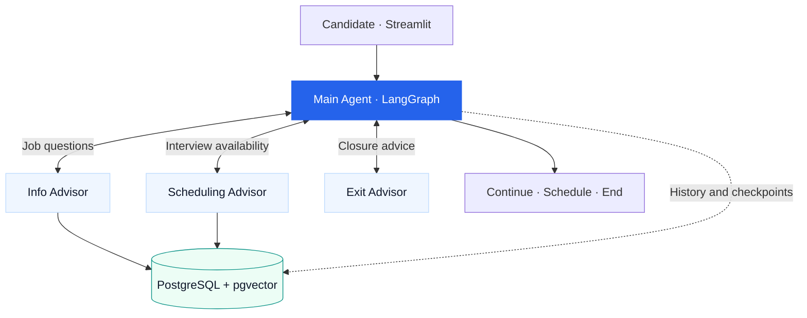
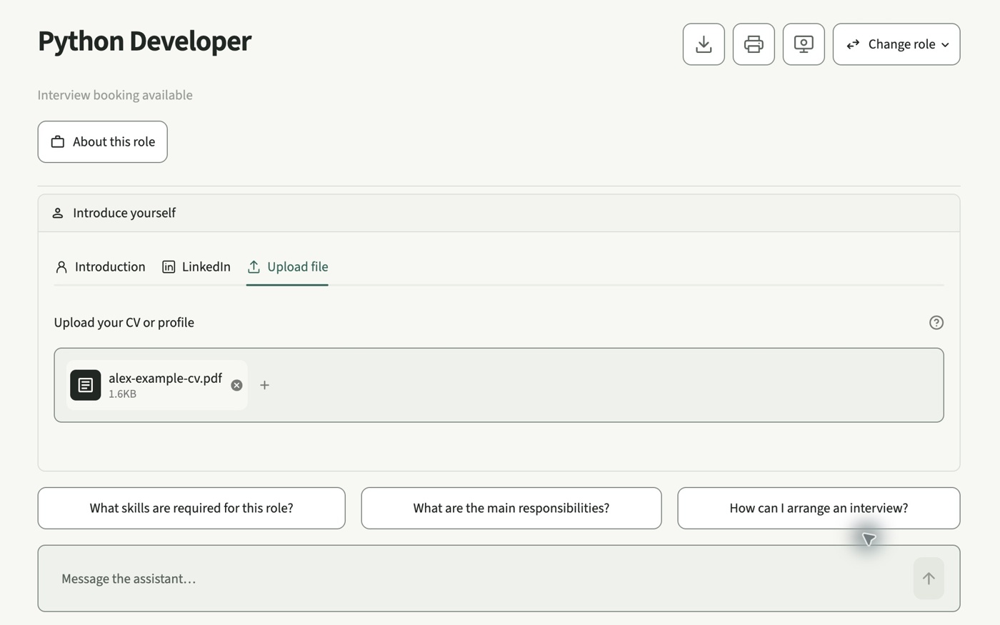
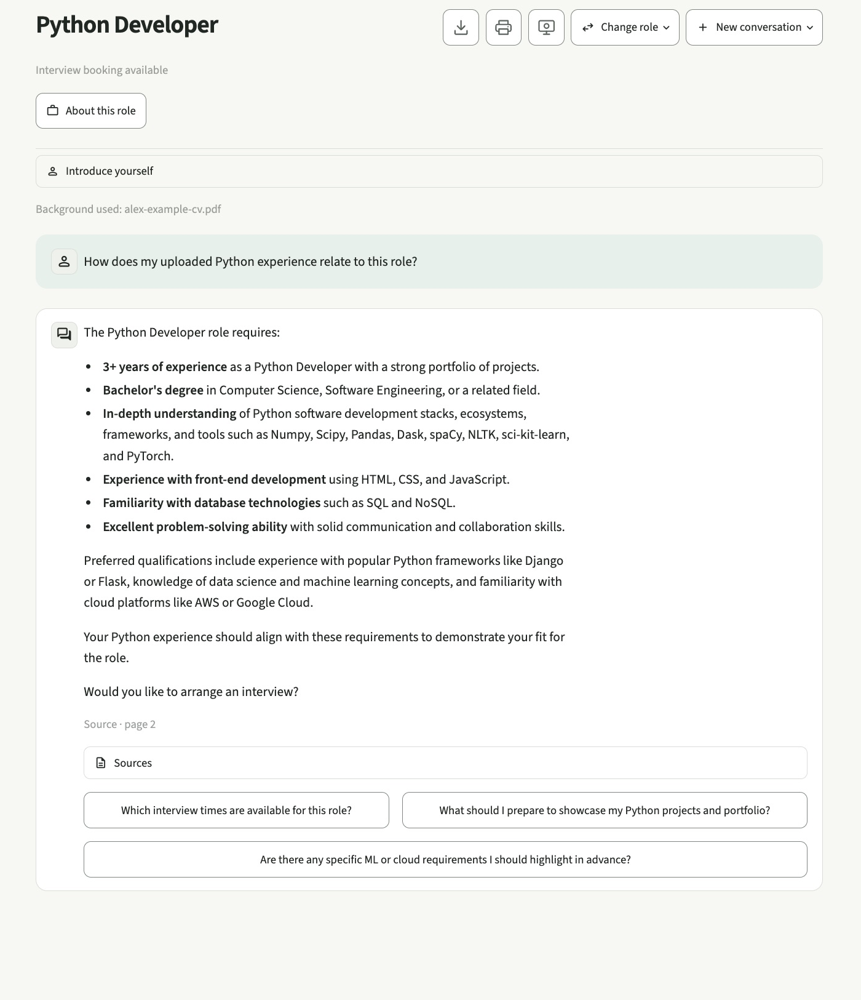
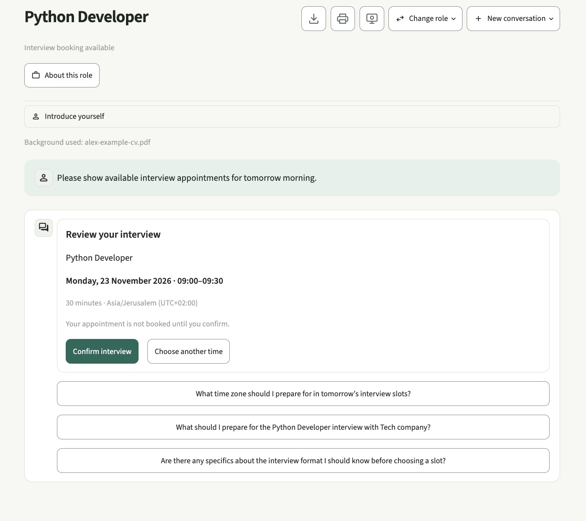
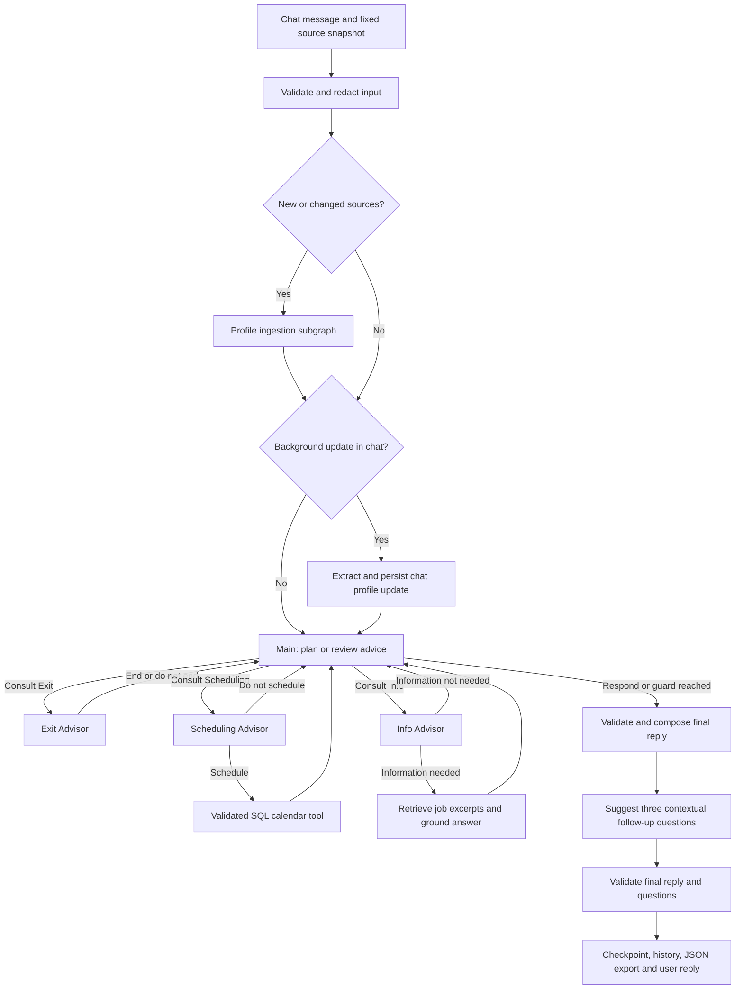

<a id="top"></a>

<div align="center">

<p><strong>TECHNION · GENAI FINAL PROJECT</strong></p>
<h1>Recruitment Assistant</h1>
<p>A multi-agent assistant for job questions, candidate introductions, and recruiter-approved interviews.</p>

<p>
  <a href="https://technion-genai-recruitment-assistant.streamlit.app"><strong>Open the app</strong></a> ·
  <a href="#quick-start">Quick start</a> ·
  <a href="#how-it-works">Architecture</a> ·
  <a href="tests/test_evals.ipynb">Evaluation notebook</a> ·
  <a href="TASK.md">Assignment</a>
</p>

<p>
  <a href="requirements.txt"></a>
  <a href="#how-it-works"></a>
  <a href="#reference-database"></a>
  <a href="LICENSE.md"></a>
</p>

</div>

---

## Overview

This project explores a recruitment conversation for a Python Developer role.
A Main Agent coordinates specialized advisors to answer questions from job PDFs,
gather candidate background, find approved interview times, and politely close
the conversation when appropriate.

| Capability | What the candidate gets |
|---|---|
| **Job-grounded answers** | Answers grounded in the assignment PDF, with page references. |
| **Candidate context** | An introduction, a LinkedIn reference, and PDF/DOC/DOCX/TXT uploads read with the next message. |
| **Interview scheduling** | Up to three available appointments in the browser's timezone, with explicit confirmation. |
| **Conversation continuity** | Durable messages, profile facts, booking receipts, and graph checkpoints in one database. |
| **Traceable decisions** | Advisor decisions, latency, model usage, and JSON conversation exports. |

The stack is **Streamlit · LangGraph / LangChain · OpenAI · PostgreSQL / pgvector**.
A locally fine-tuned **ModernBERT** classifier supplies Exit advice on the training
machine. The deployed app uses the prompted OpenAI Exit baseline.

## Quick start

Use macOS, Linux, or WSL with an OpenAI API key and a hosted PostgreSQL database
that supports pgvector. The launcher prepares Python and the project environment.

```bash
git clone https://github.com/sapir-pirski/technion-genai-recruitment-assistant.git
cd technion-genai-recruitment-assistant
cp -n .env.example .env
# Edit .env and enter your credentials.
./run-full-project.sh
```

| Variable in `.env` | Used for |
|---|---|
| `OPENAI_API_KEY` | Chat agents, embeddings, and explicitly invoked OpenAI evaluations. |
| `DATABASE_URL` | The shared hosted PostgreSQL/pgvector database, with TLS. |
| `HF_TOKEN` | Downloading the base model for explicit local Hugging Face training. |

The app opens at **[localhost:8502](http://127.0.0.1:8502)** by default. The
launcher checks Python 3.11+ (preferring 3.13), prepares `.venv`, installs missing
requirements, checks LibreOffice, verifies local model files when activated, and
initializes or reuses the assignment PDF index. A new or changed assignment PDF needs embedding
calls. Startup does not scrape jobs, train models, or download trained weights.

```bash
./run-full-project.sh --status
./run-full-project.sh --logs
./run-full-project.sh --restart --no-browser
./run-full-project.sh --stop
```

Keep `.env` private. Local classifier inference needs no HF token or network
connection. A fresh checkout uses the prompted Exit baseline until a verified
local model is explicitly trained and activated. For manual setup, Python repair,
ports, and platform details, open the [launcher reference](#reference-installation).

## Try a conversation

Add background through **Introduce yourself**, and type a message
or choose one of the three fixed starting questions. Details from all introduction
tabs are read with the next message; later edits accompany a later message.

| Try asking | Expected behavior |
|---|---|
| “What skills are required for this role?” | Retrieve the assignment job description and cite the relevant pages. |
| “Do you have anything next Friday morning?” | Resolve the date in context and search approved recruiter availability. |
| “Please stop texting me.” | End the exchange without consulting scheduling. |

LinkedIn URLs are validated references; the app does not scrape private profile
content. Use the introduction or upload a profile document to supply readable
background. The [candidate-intake reference](#reference-experience) describes
format checks, consent boundaries, profile merging, and retry behavior.

The app supports the assignment role and its configured recruiter availability.
Choosing a time opens a review. A booking is confirmed only after explicit
acceptance and a successful SQL receipt. Calendar invitations are not sent.

## How it works



Main consults advisors one at a time, reviews their results, and composes the
candidate-facing reply. Profile intake and guardrails surround that loop;
contextual follow-up questions are generated after the answer. Advisors cannot
bypass booking consent, source-grounding checks, or closure safeguards.

| Component | Responsibility | Model or tool |
|---|---|---|
| **Main** | Choose advisors and coordinate the next action. | GPT-4o mini |
| **Info** | Decide whether information is needed; answer from selected-job evidence. | GPT-5 nano + GPT-4o mini + pgvector |
| **Scheduling** | Interpret availability requests and call validated calendar functions. | GPT-4o mini + PostgreSQL |
| **Exit** | Recommend `end` or `do_not_end`. | Local ModernBERT; prompted GPT-5 nano in the deployed app |

One hosted Neon PostgreSQL database holds application state and vector retrieval:
**One assignment PDF, with 1,536-dimensional embeddings**.
The native app and Community Cloud instance use the same database. The existing
22-table schema is retained for compatibility with stored data. Local model weights and private backup archives stay outside Git.

See the [full workflow](#reference-workflow), [schema](#reference-database), and
[logging and tracing reference](#reference-observability) for implementation details.

## Evaluation

Recorded on **8 November 2026**.

The supplied benchmark contains **15 conversations and 59 labeled recruiter
turns**, split by complete conversation into 9 training, 3 validation, and 3 test
conversations. The held-out test below contains 11 recruiter turns.

| Held-out evaluation | Correct / evaluated | Accuracy | Execution failures |
|---|---:|---:|---:|
| Main workflow · all recruiter turns | 6 / 11 | 54.5% | 0 |
| Main workflow · candidate-response turns | 3 / 8 | 37.5% | 0 |
| Prompted Exit Advisor · GPT-5 nano | 10 / 11 | 90.9% | 0 |
| Fine-tuned Exit Advisor · ModernBERT | 9 / 11 | 81.8% | 0 |

**The fine-tuned classifier did not outperform the prompted baseline.** Its two
errors are false `end` recommendations. Checkpoint selection uses validation macro
F1; test conversations are excluded from training and model selection.
These are exploratory results from three held-out conversations. Historical
calendar state and booking receipts were unavailable, so action-label agreement
does not establish booking correctness.

The executed **[evaluation notebook](tests/test_evals.ipynb)** includes modern
annotated confusion matrices, class metrics, baseline comparisons, and error IDs.
It reads saved reports without making model API calls or exposing conversation text.
A separate controlled replay passed 15 turns across six fictitious cases. The
repository includes 138 Python tests and five browser-control checks.

| Runtime | Exit Advisor | Model storage |
|---|---|---|
| **Locally activated training machine** | Fine-tuned ModernBERT, using ONNX Runtime on CPU. | Git-ignored `artifacts/hf-exit/`; no model upload. |
| **Community Cloud / fresh checkout** | Prompted OpenAI baseline. | No trained weights or HF token copied to the deployment. |

Training, data isolation, model integrity and evaluation limitations are documented
in the [fine-tuning reference](#reference-evaluation).

## Assignment checklist

Checked against [TASK.md](TASK.md) on **17 November 2026** for the local
single-job / JSON-benchmark implementation. **Met** means implementation and local
evidence are present; **Needs verification** identifies an unresolved submission or
deployment question; **Missing** would identify an absent required implementation.
The suggested directory tree in `TASK.md` explicitly allows adjustments.

| Requirement from TASK.md | Status | Implementation and evidence |
|---|---|---|
| Python Developer recruitment PoC: gather background, answer questions and arrange or end an interview conversation | Met locally | [Streamlit entry point](streamlit_app/streamlit_main.py), [application service](app/service.py), and [conversation tests](tests/integration/test_conversation.py). One assignment role and PDF. |
| Main Agent chooses Continue / Schedule / End | Met locally | [Main Agent](app/agents/main_agent.py), [LangGraph workflow](app/graph/builder.py), and routing/closure/booking tests in [test_conversation.py](tests/integration/test_conversation.py). |
| Exit, Scheduling and Info advisors, coordinated by Main | Met locally | [Advisor modules](app/agents/), [graph](app/graph/builder.py), and advisor consultation / bounded-loop tests in [test_conversation.py](tests/integration/test_conversation.py). |
| LangChain and OpenAI API endpoint/models | Met locally | [OpenAI adapter](app/agents/backends/openai.py), [configuration](app/config.py), pinned [dependencies](requirements.txt), and [API-contract tests](tests/integration/test_openai_adapter.py). Test provider calls are mocked. The Exit provider exception is listed below. |
| Offline embedding of the provided PDF into PostgreSQL/pgvector | Met locally | `python -m app.main ingest`; [PDF indexer](app/ingestion/indexer.py), [PostgreSQL vector store](app/rag/store.py), and extraction/index/retrieval/repair tests in [test_rag.py](tests/integration/test_rag.py). Embedding API calls are mocked in automated tests. |
| Info Advisor answers from job evidence and encourages interview scheduling | Met locally | [Info Advisor](app/agents/info_advisor.py), [Info prompt](app/prompts/info.txt), [Main composition](app/agents/main_agent.py), and grounded-answer / unknown-information / scheduling tests. |
| SQL function calling, relative dates anchored to conversation time, and three nearest available slots | Met locally | [Scheduling tool](app/tools/scheduling.py), [date handling](app/tools/dates.py), [SQL repository](app/storage/schedule_repository.py), [calendar tests](tests/integration/test_scheduling.py), and [function-call tests](tests/integration/test_openai_adapter.py). |
| Fine-tuned Exit Advisor | Needs verification for submission | [Local ModernBERT training/export](app/fine_tuning/huggingface.py), [local inference](app/agents/backends/huggingface.py), and the [executed evaluation notebook](tests/test_evals.ipynb) demonstrate a trained classifier and 9/11 held-out predictions. Prior documentation states Hugging Face was approved, but no primary instructor approval record is included. Retain that confirmation and verify the accepted demonstration/deployment arrangement. |
| Prompt roles, API parameters, instructions and few-shot examples | Met locally | [Prompts](app/prompts/), [model policy](app/config.py), [OpenAI adapter](app/agents/backends/openai.py), and [parameter/role contract tests](tests/integration/test_openai_adapter.py). |
| Labeled real conversation benchmark, action evaluation, accuracy and confusion matrix notebook | Met locally | Private `data/sms_conversations.json`; [JSON loader and frozen splits](app/evaluation/dataset.py), [evaluation runner](app/evaluation/runner.py), [notebook](tests/test_evals.ipynb), and [JSON validation/leakage tests](tests/unit/test_dataset_json.py). The original dataset fingerprint and 9/3/3 split are preserved. |
| Streamlit application and Streamlit Community Cloud deployment | Needs verification for this checkpoint | [UI](streamlit_app/streamlit_main.py) and [UI tests](tests/integration/test_streamlit.py) pass locally. A hosted URL is documented, but this local checkpoint has not been pushed/deployed or verified on Community Cloud. Documentation identifies the deployed Exit provider as the prompted baseline; verify whether the fine-tuned advisor must run there. |
| Git repository, ignore rules, virtual environment, requirements, environment variables and installation/usage documentation | Met locally | [.gitignore](.gitignore), [requirements.txt](requirements.txt), [.env.example](.env.example), [launcher](run-full-project.sh), and this README. `.venv` and configured `.env` are local; credentials are excluded from the checkpoint backup. |
| App and Streamlit entry points, package initializers and evaluation notebook | Met locally | [app/main.py](app/main.py), [app/__init__.py](app/__init__.py), [streamlit_main.py](streamlit_app/streamlit_main.py), [streamlit_app/__init__.py](streamlit_app/__init__.py), and [test_evals.ipynb](tests/test_evals.ipynb). |
| Workflow diagram and supplied job PDF | Met locally | [Architecture diagram](#how-it-works) and [assignment PDF](data/jobs/Python%20Developer%20Job%20Description.pdf). |

No required code component is currently classified as **Missing**. Instructor
approval evidence for the Exit provider and deployment acceptance remain open;
this checklist does not infer approval from an existing README claim.
`TASK.md` does not specify a minimum accuracy. The recorded Main score (6/11),
prompted Exit score (10/11), and fine-tuned Exit score (9/11) remain separate from
mock-based behavior tests and retain their small-sample limitations. Main and
prompted-Exit reports are historical model runs; the local Exit result was
reproduced from the JSON benchmark on 17 November 2026.

The course scope does not require external job collection, company logos,
multi-role browsing, scheduled corpus synchronization, profile-document intake,
recording/printing, or detailed operational tracing. The single-role scope and
file-based benchmark are now explicit; remaining optional features can be assessed
separately without changing this checklist's requirements.

## Preserved working baseline

The local checkpoint tag is **`baseline-single-job-json`**. Its commit includes the
single-job simplification, JSON benchmark loader, tests, executed notebook, and this
checklist. Earlier implementations remain available in Git history.

A dated private backup lives under
`artifacts/baselines/2026-11-17-baseline-single-job-json/` (Git-ignored). It contains
the benchmark JSON and generated splits, the selected PyTorch checkpoint and ONNX
runtime/tokenizer, saved evaluation reports, the executed notebook, actual package
versions, verification logs, and a SHA-256 inventory. It also includes a Git bundle
for offline recovery and a source archive of this checkpoint. Credentials and the
virtual environment are excluded. The backup manifest records the exact commit,
tag, dataset/model identities and restoration commands.

Historical evaluation reports keep their original filenames and timestamps.
Save future evaluations to a new `--output` path so this baseline remains
reviewable. Reproduction uses the supplied private JSON and saved model files;
the full SQL-backed app additionally needs its configured database and API key.

## Submission verification

Verified on **8 November 2026** using fictitious candidates and a disposable QA
database. Production interview slots and bookings are excluded from booking tests.

| Check | Evidence |
|---|---|
| Main Agent and three advisors | LangGraph routing and Continue / Schedule / End checks; 15/15 controlled replay steps across six cases. |
| Fine-tuned Exit Advisor | Locally activated ModernBERT; training and held-out comparison in the notebook. Prior documentation states Hugging Face approval; primary instructor confirmation still needs to be retained. The documented public app uses the prompted OpenAI baseline. |
| PDF embedding and retrieval | Assignment PDF extraction, page citations, PostgreSQL/pgvector indexing, and incomplete-index repair. |
| SQL function calling | Three future choices, browser timezone, date interpretation, review/cancel, explicit confirmation and durable booking receipts. |
| Candidate intake | Automatic combined intake; PDF, DOC, DOCX and TXT read successfully. Invalid type, corrupt PDF and files over 5 MB are rejected. |
| Guardrails | Untrusted profile instructions, credential redaction, no booking without consent, opt-outs. |
| Browser controls | Original-PDF download matches its source bytes; print-to-PDF preserves the answer; recording downloads locally and releases capture. |
| Interface | Fixed starters, contextual questions, source references, a fixed Python Developer role and responsive layout. |
| Persistence and diagnostics | Conversation JSON, checkpoint recovery, duplicate-request protection, trace links and token accounting verified. |
| Automated checks | 138 Python cases and five browser-control cases covered. Hosted-database UI checks allow 60 seconds for completion; these are behavior checks, not latency benchmarks. |
| Repository and setup | Virtual environment, one requirements file, secret-only environment template, launcher, license, contributors and task documentation. |
| Deployment | [Streamlit Community Cloud](https://technion-genai-recruitment-assistant.streamlit.app) with hosted PostgreSQL/pgvector. |

The held-out action scores above are small-sample label agreement, with unavailable
historical calendar context; they do not establish production accuracy. Live test
turns took roughly 11–56 seconds including initialization, model calls and hosted
storage. LinkedIn links remain references, calendar invitations are not sent, and
the trained classifier stays on the local training machine.

<details>
<summary><strong>Interface screenshots from the local QA build</strong></summary>

The screenshots use public job descriptions and fictitious candidate details.

| Job description | Candidate upload |
|---|---|
|  |  |

| Conversation | Interview review |
|---|---|
|  |  |


</details>

## Project layout

```text
README.md                 Setup, architecture, data, operations, evaluation, deployment
TASK.md                   Assignment requirements
app/
  main.py                 CLI entry point
  config.py, schemas.py   Settings and contracts
  calendar.py             Approved availability windows and calendar management commands
  service.py              Shared application service
  guardrails.py           Input, model-context, tool-consent and output checks
  profiles.py             Bounded PDF/DOC/DOCX/TXT readers and grounded profile merging
  suggestions.py          Fixed questions, bounded context and contextual fallback questions
  graph/, agents/         Profile intake, Main/advisors, composition and follow-up generation
  prompts/, tools/        Role instructions and validated calendar functions
  storage/                Calendar, sources/profiles, conversation history and JSON export
  observability/          Structured diagnostics, execution spans and token usage
  rag/, ingestion/        Assignment PDF extraction, publication, and vector retrieval
  fine_tuning/            Local ModernBERT training, ONNX export and training data
  evaluation/             Dataset preparation, labeled metrics, offline quality judge and reports
streamlit_app/            Chat UI, profile inputs, presentation helpers, styles and browser controls
assets/screenshots/       Interface evidence from fictitious QA scenarios
.streamlit/config.toml    Single light theme and minimal native toolbar
config/                   Generated summary of the assignment PDF index
data/jobs/                The assignment Python Developer PDF
data/sms_conversations.json Private local benchmark input (Git-ignored)
tests/                    Automated tests and evaluation notebook
  fixtures/quality_cases.json  Independently authored fictitious quality packets
  fixtures/workflow_cases.json Controlled multi-turn booking cases
ops/                      Venv launcher support
requirements.txt          All pinned Python dependencies
packages.txt              LibreOffice system package for Streamlit Community Cloud
run-full-project.sh       Python/venv setup, dependency checks, bootstrap and app launch
```

The ignore rules cover the existing `.env`, `.venv/`, Python/test/lint caches,
`.DS_Store`, generated datasets in `data/processed/`, and generated files under
`artifacts/`, including local models, backups, logs and exports. The assignment PDF in
`data/jobs/` and `.env.example` remain tracked. PostgreSQL runtime
data is retained in Neon.
`artifacts/conversations.json` is the generated conversation snapshot.

## Reference

The operational documentation stays in this README. Expand a topic for commands,
contracts, recovery behavior, and implementation details.

| Start or develop | Understand or operate |
|---|---|
| [Installation and launcher](#reference-installation) | [Full agent workflow](#reference-workflow) |
| [Settings, models, and prompts](#reference-models) | [Guardrails](#reference-guardrails) |
| [Candidate intake and interface](#reference-experience) | [Database tables and columns](#reference-database) |
| [Recruiter calendar](#reference-calendar) | [Conversation history, logs, and traces](#reference-observability) |
| [Fine-tuning and labeled evaluation](#reference-evaluation) | [PDF sources and ingestion](#reference-ingestion) |
| [Automated checks](#reference-tests) | [Assignment PDF](#reference-ingestion) |
| [Answer-quality judge](#reference-quality) | [Deployment and verification](#reference-deployment) |

<a id="reference-installation"></a>
<details>
<summary><strong>Installation and launcher</strong></summary>

### Install and run

Clone the project, copy the environment template, and enter your credentials:

```bash
git clone https://github.com/sapir-pirski/technion-genai-recruitment-assistant.git
cd technion-genai-recruitment-assistant
cp -n .env.example .env
# Edit .env, then run:
./run-full-project.sh
```

Both `.env` and `.env.example` contain exactly three variables:

| Variable | Purpose |
|---|---|
| `OPENAI_API_KEY` | OpenAI access for agents, embeddings and explicitly invoked evaluations |
| `DATABASE_URL` | The shared hosted PostgreSQL/pgvector connection, with TLS |
| `HF_TOKEN` | Hugging Face authentication when downloading the base model for local Exit training |

The selected Hugging Face model is `answerdotai/ModernBERT-base`, fine-tuned for
the Exit Advisor's `end` / `do_not_end` classification. Training runs locally;
runtime inference reads local files and needs no Hugging Face connection or token.
No model weights, benchmark text or Hugging Face token are sent to Community Cloud.

Keep `.env` private. Use the same database connection as Community Cloud, with
`sslmode=require` or stronger verification. Startup rejects loopback database hosts.
If `.env` is missing, the launcher creates it with owner-only permissions and stops
so you can fill it in. Existing credentials are never replaced.

The launcher checks Python 3.11+ (preferring 3.13), creates or repairs `.venv`,
installs missing or changed dependencies from `requirements.txt`, checks LibreOffice,
validates credentials and published PDF indexes, starts Streamlit and opens the
browser after HTTP readiness. Healthy launches reuse the venv and dependencies.
An activated local Exit classifier is checked for compatible metadata and file
checksums before startup. Activation or model identity changes restart the managed
app. This check does not train, download model weights, or require a Hugging Face
token for local inference; machines without local activation use the prompted baseline.
Only a new or changed assignment PDF requires embedding calls; a ready index skips ingestion.
Job scraping has been removed. Model training does not run during startup.

If Python is missing, the script uses the official uv installer from
`https://astral.sh/uv/install.sh` and installs project-managed Python 3.13 under
`artifacts/launcher/`. `PYTHON_BIN=python3.13` selects a working interpreter.
An incomplete venv is preserved under `artifacts/launcher/venv-backup-*` before
replacement. Missing pip is repaired with `ensurepip`; installed package versions,
environment markers, requested extras, direct wheel versions and `pip check`
determine whether installation is needed without network access. Packages are installed
only inside the project venv.

Missing LibreOffice is installed through Homebrew on macOS or apt/dnf on supported
Linux systems. Homebrew must already be installed; Linux installation may need the
system administrator prompt. Other platforms receive a manual setup instruction.
Install the converter before processing DOC uploads; all supported document readers
are checked by `python -m app.main doctor`.

The app runs in the background at **http://127.0.0.1:8502** by default. A healthy
managed process and its port are reused. An occupied default port selects the next
free port; an explicit `--port` fails clearly when another process owns it.
The launcher checks PID, process start time and command identity before stopping
anything. It leaves unrelated applications alone. Changed app sources or repaired
dependencies restart the managed process.

```bash
./run-full-project.sh --no-browser
./run-full-project.sh --port 8503
./run-full-project.sh --status
./run-full-project.sh --logs
./run-full-project.sh --restart --no-browser
./run-full-project.sh --stop
```

`--no-browser` supports unattended use; headless hosts print the URL. Browser
opening follows HTTP readiness. Stop affects only the managed UI process; Neon and
local source files remain intact. State and owner-only logs live under
`artifacts/launcher/`. `--server.port` remains an alias for `--port`; additional
Streamlit arguments are forwarded to the server.

For manual setup:

```bash
python3.13 -m venv .venv
source .venv/bin/activate
python -m pip install -r requirements.txt
cp -n .env.example .env
# Fill in .env and install LibreOffice for your operating system.
python -m app.main doctor
python -m app.main bootstrap --if-needed
python -m streamlit run streamlit_app/streamlit_main.py --server.port 8502
```

A manually started foreground process stops with Ctrl+C. On Windows, activate the
venv with `.venv\Scripts\activate`; automatic Bash setup targets macOS/Linux/WSL.
All CLI commands below can use the activated venv or the `.venv/bin/python` binary.
The application, ingestion worker and Community Cloud share the hosted database.

</details>

<a id="reference-models"></a>
<details>
<summary><strong>Settings, model routing, and prompt contracts</strong></summary>

### Configuration and usage

Configure application behavior in the `Settings` class in
[app/config.py](app/config.py). Defaults are not repeated in the environment files.

| Setting | Default or behavior |
|---|---|
| `chat_model` | `gpt-4o-mini` for Main planning, cited job answers, scheduling tool calls and chat-profile revisions |
| `helper_model` | `gpt-5-nano` for Info classification, prompted OpenAI Exit baseline, profile extraction and follow-up questions |
| `judge_model` | `gpt-4o-mini` for explicitly invoked offline quality evaluation |
| `exit_provider` | `huggingface` when this machine has an explicit local activation receipt; otherwise `openai` |
| `hf_exit_local_path` | `artifacts/hf-exit/runtime/`; local ONNX weights, tokenizer and integrity manifest |
| `embedding_model` / `embedding_dimensions` | `text-embedding-3-small` / `None` uses the model's default dimensions |
| `business_timezone` | `UTC` fallback when browser timezone detection is unavailable |
| `request_timeout` / `max_retries` | 30 seconds / 2 retries |
| `max_output_tokens` / `model_temperature` | 1500 / 0.0 for GPT-4o mini; operation-specific limits also apply |
| `job_data_path` | `data/`; PDF inputs are its `jobs/` child |
| `job_manifest_path` | Generated `config/job_corpus_manifest.json` summary |
| `conversation_export_path` / `log_level` | `artifacts/conversations.json` / `INFO` |
| `dataset_version` / `dataset_path` | `assignment-v1` / local `data/sms_conversations.json`; file-based benchmark |
| `max_advisor_consultations` | 3 advisor visits per user turn; bounds the Main/Advisor loop |
| `chunk_size` / `chunk_overlap` / `pipeline_version` | 900 / 120 characters / `jobs-v1` |

Restart the app or notebook kernel after changing configuration. Model access
depends on your account. Chat, retrieval queries, document embeddings and evaluation
can incur API usage charges. Local training uses the host’s CPU and memory.

`Settings.model_policy()` is the single operation-to-model policy. Main planning,
Info answers, Scheduling and chat-profile revisions use GPT-4o mini. The independent
Info decision, source fact extraction and three-question generation use GPT-5
nano. The prompted OpenAI Exit baseline also uses nano; the locally activated
Exit Advisor uses its fine-tuned ModernBERT classifier instead. Nano uses
`reasoning_effort="low"` for Exit classification and profile extraction, and
`"minimal"` for Info decisions and follow-ups, and omits temperature. Generative OpenAI requests use
`max_completion_tokens`: Exit is capped at 512, Info decisions at 1,024, follow-ups at
768, and planning, answers, scheduling and profile extraction at 1,500; lowering
`max_output_tokens` lowers these caps too. Completion limits include reasoning
tokens, so a request can exhaust its budget before returning a usable answer;
see [OpenAI's reasoning-token guidance](https://developers.openai.com/api/docs/guides/reasoning#controlling-costs).
Changing model families requires checking their supported parameters.
There is no automatic escalation to a more expensive model. API failures retain
the existing error/retry behavior; invalid follow-ups retain their local fallback.
The Main/advisor loop, SQL tool validation, explicit booking confirmation and
source-grounding checks remain in force. Final reply assembly is Python code.

Prompts live in `app/prompts/`, with one file per task. GPT-4o mini receives system
instructions with explicit decision rules, field meanings and targeted examples.
GPT-5 nano receives developer instructions with concise goals and constraints;
it is not asked to reveal reasoning. Context JSON or profile text is sent in a
separate user message. Examples are independently authored and do not use the
stored benchmark. This follows OpenAI's
[prompt guidance](https://developers.openai.com/api/docs/guides/prompt-engineering)
and [reasoning guidance](https://developers.openai.com/api/docs/guides/reasoning-best-practices).

| Prompt | Default model | Purpose and important rules |
|---|---|---|
| `main.txt` | GPT-4o mini | Main's routing priorities, first advisor consultation, mixed requests, profile corrections and bounded follow-up consultations |
| `scheduling.txt` | GPT-4o mini | One calendar call when needed; no invented date preferences, AM/PM or acceptance; SQL remains authoritative |
| `info.txt` | GPT-4o mini | Under-100-word answers grounded in supplied excerpts; partially covered answers cite supported facts and identify missing details |
| `info_decision.txt` | GPT-5 nano | Outstanding candidate questions versus experience-only, calendar-only or already handled requests |
| `exit.txt` | GPT-5 nano, prompted OpenAI baseline | Exactly `end`/`do_not_end`, including slot rejection, negated disinterest and unanswered questions; no claim that history verifies a booking |
| `profile.txt` | GPT-5 nano | Verbatim source fact extraction, null/empty missing fields, no inferred durations or paraphrasing |
| `chat_profile.txt` | GPT-4o mini | Grounded latest-message facts and exact known fact IDs for explicit corrections or confirmations |
| `followups.txt` | GPT-5 nano | Exactly three candidate questions, related details when available and clarification when information is missing |
| `judge.txt` | GPT-4o mini | Offline answer-quality rubric, evidence references, unassessable ratings and brief reasons |

The backend snapshots prompt text when it is created. Each model-call span stores
`prompt_name`, `prompt_sha256` and `instruction_role` in its existing JSONB
attributes, never the prompt or candidate text. Evaluation reports contain a
`prompt_manifest` with the same identifiers per operation. Restart the app or
notebook kernel after a prompt edit so the new prompt and hash load together.
The profile cache includes the extraction prompt hash and instruction role.

The CLI doctor, evaluation reports and evaluation notebook display the complete
model policy. Changing only the chat model does not invalidate extracted candidate
profiles; their identity includes the extraction model, parameters and prompt.
Unchanged source facts are reused. Switching chat/helper models does not change
the embedding identity or require re-embedding PDFs.

Standard USD prices per million text tokens, checked on 7 November 2026:

| Model | Uncached input | Cached input | Output |
|---|---:|---:|---:|
| `gpt-4o-mini` | $0.15 | $0.075 | $0.60 |
| `gpt-5-nano` | $0.05 | $0.005 | $0.40 |
| `text-embedding-3-small` | $0.02 | — | — |

See [OpenAI pricing](https://developers.openai.com/api/docs/pricing). These rates
are not a promise of savings: reasoning, context, retries and actual model quality
affect cost per successful conversation. The dated estimator covers Standard text
requests only, excluding special processing tiers and discounts.

This is a short-term assignment configuration. OpenAI lists **11 December 2026**
as GPT-5 nano's shutdown date and **14 January 2027** for GPT-4o mini. Replace and
evaluate these models before those dates; do not silently switch a running app.
See the [official deprecations](https://developers.openai.com/api/docs/deprecations).
GPT-5 nano remains the prompted Exit baseline used by Community Cloud. The local
ModernBERT classifier is fine-tuned, with results and limitations below.
The local ModernBERT classifier has no generative prompt or sampling parameters. Its trace records the versioned history-input contract and artifact SHA-256 instead.

</details>

<a id="reference-experience"></a>
<details>
<summary><strong>Candidate intake, uploads, and chat interface</strong></summary>

### Candidate experience

The header shows the assignment's **Python Developer** position. Type directly into
the message box or use a suggested question. There is no role selector or separate
start screen. Try:

- “I have four years of Python experience.”
- “What skills does this role require?”
- “Do you have anything next Friday morning?”
- “Please stop texting me.”

**About this role** opens an accessible reading dialog with the complete description
extracted from the assignment PDF. The stored presentation preserves headings,
emphasis and lists, with raw HTML and embedded images disabled. Opening it makes
no model calls. Escape, the close icon or **Close description** dismisses it.

The header retains **Download PDF**, **Print**, and **Record**. Download PDF returns
the original assignment document. New conversations always concern the same role.
Company logos and external employer-posting links have been removed.

The app uses one warm light theme, configured in `.streamlit/config.toml` and the
shared color variables in `streamlit_app/styles.css`. Streamlit hides the
System/Light/Dark choices from its menu. The custom header controls inherit the
same variables as the chat; no theme selector is exposed to candidates.

| Role | Color |
|---|---|
| Page background | Warm off-white `#F7F7F3` |
| Cards and assistant messages | White `#FFFFFF` |
| Input backgrounds | Light neutral `#EEF1EC` |
| Main / secondary text | Charcoal `#202722` / muted gray-green `#58635C` |
| Primary / hover | Deep teal `#21685B` / dark teal `#194E45` |
| Candidate messages and selected fills | Pale sage `#E6F0EB` |
| Decorative borders / control outlines | `#D8DED7` / `#7C8980` |

Send and confirmation actions use teal, while question buttons stay white with a
subtle sage hover. Selected tabs retain their underline, and keyboard focus has a
solid teal outline. Placeholders use the secondary text color. Success messages
use green, warnings amber, and errors and active recording use red, with their
existing text and icons.

The specified palette pairs provide contrast of 6.57:1 for white on teal,
6.26:1 for secondary text on white, 5.49:1 for secondary text on input backgrounds,
and at least 3.21:1 for control outlines against their adjacent input fill.
These are color-pair calculations, rather than a full accessibility certification.

The outlined Print and Record icons open their respective browser controls.
**Print** opens a conversation-only print layout with speaker labels, citations and
booking details, excluding intake controls, action buttons and icon-font names.
The browser can print it or save it as a PDF. **Record screen** opens the browser's
sharing picker; after you choose a surface, it changes to a red **Stop recording**
icon. Stopping from the icon or browser sharing controls downloads the video
locally (WebM or MP4, depending on browser support). A download link is available
if the browser blocks the automatic download. Recording captures video only;
it uses no microphone, and videos never go to the app server or database.
Screen recording requires a supported desktop browser and HTTPS or localhost.
The request prefers and includes the app’s own tab where supported; the browser
still controls permission and surface selection. See the
[screen-capture API options](https://developer.mozilla.org/en-US/docs/Web/API/MediaDevices/getDisplayMedia#parameters).
The buttons show compact dark tooltips below the icons after a 200 ms hover or
keyboard-focus delay: **Download job description (PDF)**, **Print conversation**, **Record screen**, or **Stop
recording** while active. Tooltips dismiss when the pointer/focus leaves or Escape
is pressed. Keyboard focus styles and accessible labels are included.

Expand **Introduce yourself** for **Introduction · LinkedIn · Upload file**.
Small person, LinkedIn and upload icons appear before the labels and follow the
selected tab's teal highlight.
The panels share a compact minimum height and top alignment, with reduced bottom
spacing, and grow naturally when document details need more room.
All tabs provide background context: type an introduction, add a LinkedIn reference,
and/or attach a PDF, DOC, DOCX or TXT document. There are no separate send,
read or review buttons. Send your first chat message, or choose a suggested
question, and the assistant automatically processes every populated tab before
responding. Merely opening the page, typing or switching tabs makes no model call.
The panel stays available during an active conversation; later changes are read
with the next message. **New conversation** clears these inputs.

Inputs are ordinary Streamlit widgets, so changes reach session state without a
form submission. Each message captures all tab values, including inactive tabs,
into one fixed request snapshot. Retries reuse that snapshot. Pending requests
lock inputs; a UI rerun does not submit another request. Actual sent messages
remain the conversation turns; extracted profile text is separate context.

LinkedIn URLs are references only; the app does not fetch profiles or use browser
cookies. The LinkedIn tab contains only **LinkedIn reference URL**, with a tooltip
explaining this limitation. Local syntax validation shows malformed links beside
the field without fetching a page or calling a model. It does not verify existence,
accessibility or ownership. Use Introduction or Upload file to supply profile information.
A URL alone is saved as a reference and the chat continues normally. Broader Profile API access requires approval
([LinkedIn Profile API](https://learn.microsoft.com/en-us/linkedin/shared/integrations/people/profile-api)).

Uploads are limited to 5 MB, with at most 10 PDF pages and 24,000 extracted
characters per source. The native upload button shows only its upload icon, with
an **Upload CV or profile** tooltip on hover or keyboard focus. Its accessible
**Upload CV or profile** label, file picker, allowed-format/size text and validation
remain available. The tooltip is hoverable, stays visible as the pointer moves onto
it, and dismisses with Escape without moving keyboard focus.
The introduction box accepts 4,000 characters. PDF reading
uses PyMuPDF; DOCX reading uses python-docx and includes paragraph/table text;
TXT supports UTF-8 (including BOM) and UTF-16 with BOM. Legacy DOC uses LibreOffice
headless conversion in a private temporary directory, with macros disabled and
a 30-second conversion timeout. Install LibreOffice locally before startup:

```bash
# macOS
brew install --cask libreoffice
# Ubuntu/Debian
sudo apt-get install libreoffice-writer
```

`run-full-project.sh` checks the converter after Python dependency installation;
`doctor` reports `document_converter_ready`. Streamlit Community Cloud installs
`libreoffice-writer` through the root `packages.txt`. Password protected, scanned,
corrupt, oversized or unsupported documents produce a source-specific message.
OCR is not automatic. Valid sources and the actual chat request still proceed.
Document-reading errors appear beside the current upload, and introduction errors
beside that text area. The panel opens for matching source failures. Content hashes
and filenames prevent an error from a replaced file appearing on the new file;
document parsing and model extraction still happen with a real message.

The `profile_ingestion` LangGraph subgraph validates sources, reads documents,
extracts verbatim facts, merges them, and publishes a versioned candidate profile.
Each fact must match its source text. Exact repeated facts merge while retaining
all supporting source IDs. Different names and conflicting explicit numeric
Python-experience claims are flagged for clarification. Career duration is never
converted into Python experience. The separate `chat_profile` subgraph runs for
relevant background statements before Main: `extract_chat_update` then `persist_chat_update`. It extracts only
facts whose words match the durable latest user message and reads the preceding
assistant question to interpret short replies. An added terminal sentence stop can
be removed when the retained excerpt matches the source; no words are repaired or
invented. Main receives active profile
sections, conflicts, missing details and verification status.

A differing claim preserves both versions and prompts clarification. Only an
explicit correction with a grounded replacement can supersede a known fact.
Unsupported model-proposed facts and revisions are ignored independently, so valid
new facts or confirmations can still be kept. Rejection counts are traced without
logging the rejected text.
Each claim retains its stable fact ID, source or actual chat message/request IDs,
active/superseded status and self-reported/confirmed-by-candidate status. An explicit
confirmation references the particular supported claim; ambiguous yes replies cannot
choose between conflicts. Confirmation records what the candidate affirmed and does
not verify credentials externally. Superseded evidence stays in the audit history.

Chat updates and verification are JSON inside `candidate_profiles.data`. Source
changes preserve chat updates. Checkpointing extraction before publication lets a failed profile write
resume without repeating a completed model call. A chat-extraction failure is traced
and leaves the prior profile intact; the candidate can restate the information.
Name comparison tolerates a terminal full stop while keeping original evidence
quotes and distinct names. Profile content is untrusted background data and cannot request scheduling, alter
tools, or establish job requirements.
Only Main receives the derived candidate profile. Calendar and information-decision
model requests use actual conversation history and their task context without
copying background documents into those advisors' prompts.

Content hashes scoped to the conversation and the parser/model/prompt version
reuse completed extraction. Each new or changed nonempty text/document source
can make one extraction call; SDK retries are bounded by the existing retry setting.
Transient extraction failures can be attempted again on later turns, up to three
logical source attempts. Invalid documents and unsupported extraction results are
terminal until the candidate replaces or edits that source. Explicit opt-outs skip
source capture and extraction. An empty background behaves like ordinary chat.

The first message and source IDs are saved atomically before graph execution.
Pending upload bytes live temporarily in PostgreSQL for recovery, then are cleared
after successful text extraction or terminal failure. Extracted text, source
hashes, facts, errors and profile versions remain in PostgreSQL until explicitly
removed. No candidate files are added to `data/jobs/`. Graph checkpoints contain
source references and the compact derived profile, rather than uploaded bytes or
full document text. The subgraph inherits the parent PostgreSQL checkpointer;
synchronous checkpoint writes and idempotent source/profile writes allow a worker
to resume the same thread/request. A provider call interrupted before its result
is durably recorded can still be repeated. Candidate profiles never enter job RAG.

The timezone is automatically detected through Streamlit's browser context for
each new conversation, with `business_timezone` as a fallback when detection is
unavailable. A small **Times shown in …** label appears beside available interviews.
Appointment review and confirmation also include the timezone. Position and
timezone stay fixed during a conversation so retries and bookings remain consistent.
**New conversation** starts a fresh thread and clears the form; it preserves
recorded messages and confirmed bookings.

Available interview times appear inside the latest assistant message as up to
three cards showing the full date,
start/end time and duration when known, IANA timezone, and the appointment's UTC
offset. **Choose time** opens a review without booking. **Confirm interview** sends
the existing validated calendar request; confirmation appears only after a SQL
booking receipt. You can also accept an offered appointment explicitly in chat.
If a slot is no longer available, the service asks for another time. Calendar
invitations are not sent by this app.
The cards replace only the exact generated availability list associated with that
answer's receipt. A confirmed receipt also presents its date once. PostgreSQL,
JSON exports and CLI responses retain the full original text. Older transcript
messages keep their text and do not expose stale booking buttons.

Factual answers show a compact **Source · page …** reference and retain their own
**Sources** expander with readable PDF names
and page numbers, resolved from the cited chunks for that job without another
embedding or model request. If earlier chunks have been retired, the UI says
their details are unavailable and offers the current description above. Raw
chunk IDs and execution traces are kept out of the candidate view.

Pending submissions disable further input. On a request failure, the submitted
information remains available and **Retry request** reuses its original request
ID, preventing duplicate bookings. Opening job details or changing other display
controls never silently retries a failed request.

Pending replies appear as an assistant bubble with real progress labels for source
reading, job-information lookup and interview availability. After Main composes the
verified reply, the UI can display that answer while follow-up generation finishes.
The graph still publishes one complete answer/suggestion receipt and transcript
turn. Interrupted display callbacks are logged safely without undoing a booking or
rerunning model work; retries use the existing request ID and checkpoints. An
interrupted browser request retains its submitted information and composed answer.

Each new conversation starts with the same three clickable questions, for every job:

- **What skills are required for this role?**
- **What are the main responsibilities?**
- **How can I arrange an interview?**

The starting questions appear in the chat composer, directly above the message input.
Before the first message, this composer sits directly below **Introduce yourself**.
Once the conversation starts, the input stays pinned to the bottom of the window.
Displaying the questions does not create a conversation turn or call a model.
Clicking a question sends its exact text as a normal candidate message and includes the current introduction,
LinkedIn reference and uploaded document snapshot.

After an active assistant answer, three short contextual questions appear inside
the latest assistant message, beneath its answer. They are questions the candidate
can ask, based on the selected job, recent dialogue, latest response and appointment state. Suggestions are hidden
while a request is pending and after the conversation closes. Earlier answers retain
their saved suggestions in PostgreSQL and exports, but only the latest answer's
questions are shown as buttons. Rerendering never generates new suggestions.
Question buttons use consistent wrapping and stretch to share the row. At narrow
widths they and appointment cards stack vertically, retaining full labels and
44-pixel button targets. Header controls also wrap below the title.

The frontend preserves the reading position when the candidate scrolls away from
the latest answer. A new reply brings its beginning into view only when following
the conversation; long replies are not continuously scrolled to their end. **Latest
message** offers a jump when the latest answer is outside the visible reading area.
The composer uses browser visual-viewport information for keyboard clearance and
reserves scroll space for the pinned input. This behavior and upload tooltip events
are frontend-only; they send no document text or events to another service.

Imported postings answer job questions and link to their source. Their recruiter
calendars are not connected. Booking requires authorized availability in PostgreSQL
and scheduling enabled for the selected job; startup never generates appointments.
For a terminal conversation, run `python -m app.main chat`.

</details>

<a id="reference-calendar"></a>
<details>
<summary><strong>Recruiter calendar and interview management</strong></summary>

### Recruiter calendar

The assignment calendar was configured with 160 user-approved, 30-minute appointments for
**4–17 November 2026**, Sunday–Thursday, **09:00–17:00 Asia/Jerusalem**. SQL stores
their UTC start times and duration; the UI displays the selected timezone. The
last start each day is 16:30 local time. The existing historical booking is retained.
This finite calendar is not extended automatically; future availability requires
new recruiter-approved dates. Imported postings do not share these slots.

Calendar management uses the same two tables, `interview_slots` and
`interview_bookings`. Operators with database credentials can inspect remaining
availability and its expiration:

```bash
python -m app.main calendar status \
  --job-id assignment-python-developer --timezone Asia/Jerusalem
```

The JSON output includes `status` (`available`, `fully_booked`, `expired`, `empty`
or `disabled`), `future_available`, `past_unbooked`, `bookings_total`,
`last_configured_date`, `days_until_last_date`, the last appointment and the next
three available slots. Past rows are retained for history and excluded from offers.

To validate an additional date range, supply recruiter-approved dates, working
weekdays, local hours, timezone and duration explicitly. The following dates are
an example proposal and have **not** been added to the configured calendar:

```bash
python -m app.main calendar add \
  --job-id assignment-python-developer \
  --from-date 2026-11-18 --to-date 2026-12-01 \
  --weekdays sun mon tue wed thu \
  --start-time 09:00 --end-time 17:00 \
  --timezone Asia/Jerusalem --duration-minutes 30 --dry-run
```

`--dry-run` validates the complete request without changing appointments; technical
traces are still recorded. To add an approved range, run the command with the
approved arguments and omit `--dry-run`. Ranges are inclusive and limited to 366
days and 10,000 appointments per command; durations are 1–480 minutes. Hours must
stay within one local day and divide evenly into complete appointments. Ambiguous,
nonexistent or duration-changing daylight-saving times require different hours.
Every appointment must start in the future. An invalid request, duplicate or
overlapping appointment rejects the entire addition. Per-job database locking
serializes concurrent calendar additions. Existing appointments, including booked
or unavailable ones, remain intact. Future slots require a duration for overlap
validation. The selected job must be active with scheduling enabled; calendar management applies to the assignment role.

These commands use PostgreSQL without calling OpenAI. Run the project launcher
first to initialize storage. Calendar operations use the application’s SQL
repositories and per-job locks.

Availability searches apply job, date, local-time, morning/afternoon and declined
slot filters in SQL before limiting results. With no date preference, the next
three future appointments can be found beyond 30 days. If only one or two match
a preference, nearby alternatives fill the remaining places, without duplicates.
Both the answer and appointment cards label alternatives. Explicit limits such as
“only tomorrow” remain binding; fewer than three options are shown when the calendar
cannot meet those limits. Alternatives always need their own confirmation.

Resolved preferences live in the existing graph checkpoint JSON under
`schedule_preferences`, with their original phrase, reference timestamp, timezone
and request ID. A follow-up such as “morning works” reuses the original resolved
date even after a week boundary. An explicitly repeated relative date is resolved
against the new turn. “Any day” clears the date, “any time” clears time preferences,
and “no preferences” clears all constraints. With a period but no exact time, ranking uses 09:00 for
morning or 15:00 for afternoon; a bare date uses local midnight.

If an offered appointment is taken before confirmation, the tool refreshes
alternatives immediately and excludes the failed choice and declined slots. It
never books a replacement automatically. A model's acceptance flag alone cannot
book a slot; the candidate's latest message or explicit UI selection must support
consent. An exhausted calendar reports that a recruiter needs to add availability.
These lookups remain inside the existing calendar tool and Scheduling Advisor
node and add no model calls.

Scheduling, conversation and CLI tests cover calendar additions, availability
queries, explicit acceptance and booking conflicts.

</details>

<a id="reference-workflow"></a>
<details>
<summary><strong>Detailed LangGraph workflow and booking behavior</strong></summary>

### Architecture and booking behavior

The Main Agent coordinates three advisors through LangGraph:



Main chooses one advisor at a time and reviews its result before choosing another
advisor or replying. There is no mandatory advisor order. Each advisor receives
bounded recent candidate/recruiter history; the full transcript stays in PostgreSQL.
Advisor outputs stay in internal state;
only the final Main reply is added to the transcript.

Exit returns `end/do_not_end`; Scheduling returns `schedule/do_not_schedule`;
Info returns `info_needed/info_not_needed`. The latter two decisions gate calendar
availability searches and vector retrieval. Main retains the original user intents
when reviewing results so mixed information/booking requests are handled together.
A helper’s negative Info classification cannot erase a new explicit candidate
question already identified by Main; that question is preserved for source-grounded
retrieval. Only SQL receipts establish a confirmed booking. Main supplies a closure intent:
`opt_out` for actual disinterest, `scheduled` for a completed booked exchange, or
null. A binary Exit `end` label cannot close a scheduling exchange on its own.
The final result records `closure_reason` as `opt_out` or `scheduled`; the latter
requires a matching SQL receipt. Ambiguous closure stays active for clarification.
A pure closing acknowledgment after a confirmed booking retains `scheduled`
completion even if a model confuses it with disinterest. An explicit stop request
still produces `opt_out`.

The default limit is three consultations, configured in `app/config.py`. Repeating
the same advisor task with unchanged inputs is blocked. Before stopping, Main
routes any remaining known request to its unconsulted advisor within the budget.
The routing history records `rerouted_from`. Counts and results reset
for each user turn. Main handles errors and exhausted budgets with verified partial
results or a clarification response. `routing_history`, decision codes, and stop
reasons are traced without raw prompts or internal reasoning text. The limit counts
advisor visits; planning, decision checks, and grounded-answer model calls have
their own usage spans. Actions (`continue`, `schedule`, `end`), booking state,
and conversation state are separate.

The `suggest_followups` node runs after `compose`, outside the advisor loop, followed
by the final `output_guard` check.
Its structured model call has no tools and cannot alter the composed answer, profile,
booking, action or conversation status. It receives job metadata, the last 12 messages
(up to 2,000 characters each), the latest answer (up to 6,000 characters), the last 30
suggestions and booking/availability flags. Full profile documents and extracted text
are not included. Its call is traced separately and uses the configured helper model,
timeout and bounded SDK retries; it adds one model operation to an active successful
turn. Closed conversations and action evaluation skip generation. Failed answers use
fallback questions without making another suggestion-model call.

Output validation requires exactly three distinct, single-line questions, each
10–140 characters and ending in one question mark, without links or markup.
The prompt directs at least two questions to build on details in the latest answer.
Exact matches to candidate
messages and the last 30 offered suggestions are rejected after punctuation/case
normalization. The prompt also asks the model to avoid already answered topics and
semantic repetition; that semantic check is model-based, rather than a guarantee.
Invalid output or provider failure uses three capability-aware fallback questions
without failing the answer. Fallbacks favor fresh questions about the current topic,
offered dates, interview preparation or employer next steps. If a prolonged outage
exhausts that finite pool, older fallback questions may be reused.

Suggestion IDs are derived from the conversation, answer request and question text.
The answer and its questions share the durable response receipt. An interruption
after composition resumes at the pending suggestion node, without rerunning advisors
or booking tools. A provider call interrupted before checkpointing can still repeat;
completed requests and refreshes reuse the saved questions. A different request cannot
overtake an unfinished one.

- Calendar tools accept validated arguments; models cannot execute arbitrary SQL.
- Offer up to three chronological appointments for the selected job and position,
  excluding declined slots. Search newly proposed dates before previously offered times.
- Book only an explicitly accepted slot already offered in that conversation.
  Conditional updates and uniqueness constraints prevent double booking; repeated
  requests return the existing receipt.
- Opt-outs suppress scheduling. Booking can conclude with `end`; booking alongside
  a job question can remain `continue`.
- Store times in UTC and display the selected timezone. Resolve relative dates from
  the incoming message timestamp, including historical timestamps in evaluation.
- “Next Friday” means Friday of the following ISO week; “Friday” or “this Friday”
  means the next occurrence, including today. Clarify ambiguous numeric dates,
  missing AM/PM, and nonexistent or repeated daylight-saving times.
- Supported date inputs include ISO dates, full English dates, weekdays, today,
  and tomorrow. Other phrases need an exact date. Show the absolute date before booking.

The Info Advisor retrieves only the selected job's complete published document
versions and cites excerpt IDs internally. Unsupported facts receive a “not
specified” answer; earlier recruiter messages are not authoritative job facts.

LangGraph checkpoints persist opaque conversation UUIDs in PostgreSQL. A restored
UUID can resume after a process restart, but browser refresh may create a new
Streamlit session. Authentication, cross-device recovery, calendar invitations,
cancellation, and rescheduling are not implemented.

</details>

<a id="reference-guardrails"></a>
<details>
<summary><strong>Input, model, tool, and output guardrails</strong></summary>

### Runtime guardrails

`app/guardrails.py` supplies shared checks at graph entry, model input, retrieval,
calendar booking and final output. These checks in code add no model calls,
dependencies, environment variables or database tables. They preserve the Main
Agent and its three advisors, Continue/Schedule/End decisions, SQL scheduling and
offline embedding required by the assignment. The quality judge remains offline.

| Boundary | Enforcement |
|---|---|
| Input | Candidate/assistant dialogue roles only; chat messages remain limited to 4,000 characters. Recognizable credentials are redacted before new chat/plaintext background is stored and processed. |
| Profile documents | Existing format, byte, page and extracted-text limits remain. Credential patterns are redacted after reading a document and before saving extracted text or requesting profile facts. Temporary original upload bytes are cleared after extraction; they may briefly exist in PostgreSQL while processing is pending. |
| Model context | Send at most the latest 12 messages within a 16,000-character history budget. Reject complete user payloads over 48,000 characters instead of silently cutting profile facts or evidence. These are character bounds, not exact token counts. Fixed prompts and output tokens have separate limits. |
| Retrieved evidence | Reject explicitly mismatched job IDs and supported answers with missing or unknown source IDs. Track retrieved IDs per turn so final citations can be checked again. |
| Calendar write | Require a previously offered slot and verify acceptance against the current candidate message or trusted UI selection before calling the SQL booking transaction. Model acceptance flags alone cannot authorize a booking. |
| Reply | Compare booking data with a fresh SQL receipt, validate action/status consistency and source IDs, bound reply length, redact recognizable credentials and reject detected confirmation claims outside the receipt-derived text. |
| Follow-up questions | Retain the three-question schema and repetition checks; reject recognized booking/cancellation commands and requests for credentials or sensitive identifiers. Use existing local fallbacks without another model call. |

Recognized credential patterns include sufficiently long `sk-…` tokens, AWS access
key IDs, GitHub token prefixes, bearer tokens, private-key blocks, explicit
`api_key`/`password`/`client_secret` assignments and connection URLs containing
passwords. Names, contact details and relevant candidate experience are preserved.
Recognition is deliberately limited: unfamiliar credentials and semantic leaks can
be missed. Existing historical rows, original job PDFs and prior exports are not
retroactively rewritten. Quality packets containing detected credentials are
rejected before the judge call so their evidence is not silently changed.

The graph starts with `input_guard`, before optional profile ingestion and Main.
Composition validates its response before returning any `answer_ready` event;
`output_guard` checks the final result after suggestions and before the durable
conversation receipt and JSON export. Intermediate graph checkpoints still support
recovery. Main/advisor results are scrubbed for recognizable credentials before
checkpointing. No unchecked assistant text is displayed by the early-answer callback.
An inconsistent reply becomes a controlled clarification. If SQL already recorded
a booking, the fallback preserves and reports that real receipt without rebooking.

Booking consent uses a conservative English grammar. For example, “I accept the
first appointment” resolves the first offered slot; “I accept 10:00” must match one
offered time and the actual date/time phrase in the message. A bare “yes” cannot
select between several offered slots. Quoted text, negation, uncertain wording or
an unverified selector produces clarification; the Confirm interview UI remains
available. Documents and advisor assertions cannot supply consent. A Main Agent
stop flag alone also cannot close a conversation: an actual opt-out or Exit
Advisor decision based on dialogue is required.

Each check uses existing `trace_spans` with `component=guardrail`. JSONB attributes
and structured JSON log events contain `rule_id`, `stage`, `outcome`
(`allow`, `clarify`, `redact` or `block`) and `reason_code`; spans supply duration,
trace/request/conversation IDs. They do not contain rejected text or credentials.
For example:

```json
{"rule_id":"booking_consent","stage":"tool","outcome":"clarify","reason_code":"acceptance_not_verified"}
```

These controls enforce specific invariants, not complete prompt-injection detection
or semantic factuality. A real citation can still accompany an unsupported claim;
prompts and the offline judge support review of those cases. Pattern checks can
also need clarification for legitimate wording. Adversarial tests use fictitious
inputs and mocked models to cover injection through profiles, unauthorized SQL
writes, fabricated receipts/citations, credential redaction before display/export,
unsafe suggestions and legitimate mixed information/booking requests.

Guardrail tests use isolated PostgreSQL databases and mocked models. Retry
recovery reuses the redacted message without repeating completed model work.

</details>

<a id="reference-database"></a>
<details>
<summary><strong>PostgreSQL tables, columns, and storage design</strong></summary>

### Database and schema

One PostgreSQL database with pgvector stores catalog records, embeddings, bookings,
conversation history, execution traces, and LangGraph checkpoints. Runtime storage uses the same `DATABASE_URL`; benchmark input is local JSON.
The local venv application and Community Cloud instance connect
to the same hosted database.
Initialization creates the vector extension and final tables when absent, under
an advisory lock, without resetting data. The project has no running local database
or database volume.

The initialized application has **22 tables**: 18 application tables below and
four managed by LangGraph. Catalog/calendar models are in [app/ingestion/models.py](app/ingestion/models.py)
and [app/storage/models.py](app/storage/models.py); vectors are defined in
[app/rag/models.py](app/rag/models.py).

| Table | Main columns and purpose |
|---|---|
| `companies` | `company_id` PK, unique `identity_key`, `name`, `website_url`, `logo_source_url`, PNG `logo_data` BYTEA, `logo_mime_type`, `logo_sha256`, `logo_pipeline_version`, `logo_etag`, `logo_last_modified`, `logo_checked_at`, `logo_updated_at`, `logo_status`, nullable `logo_error_code` |
| `job_sources` | `source_id` PK, `provider`, `board_identifier`, nullable `company_id` FK, `company_name`, `enabled`, `last_successful_sync_at` |
| `jobs` | `job_id` PK, `source_id` FK, nullable `company_id` FK, `external_job_id`, `canonical_url`, `company_name`, `title`, `description_text`, `description_format` (`plain` or `markdown`), `employment_type`, `seniority`, `workplace_type`, `compensation`, `locations` JSONB array, `status`, source timestamps, `first_seen_at`, `last_seen_at`, `closed_at`, `missing_scans`, `scheduling_enabled` |
| `job_documents` | `document_id` PK, `job_id` FK, `source_path`, `source_url`, `enabled` |
| `document_versions` | `document_version_id` PK, `document_id` FK, PDF path and PDF/text SHA-256 hashes, `pdf_data` BYTEA, `presentation` JSONB (canonical text/format, public job metadata, source notes, format version), pipeline/model/dimensions, collection, expected/indexed chunk counts, status, indexing time, error code, `is_active` publication flag |
| `ingestion_runs` | `run_id` PK, trigger, start/end timestamps, status, aggregate counts, `items` JSONB array of processing outcomes |
| `sync_leases` | Lease ID, owner, expiration; prevents overlapping assignment PDF ingestion |
| `interview_slots` | Slot ID, job ID, UTC start, position, availability, nullable positive `duration_minutes` (unknown for historical records) |
| `interview_bookings` | Booking ID, job ID, slot FK, conversation ID, request ID, creation time |
| `rag_collections` | Collection ID PK, embedding model, vector dimensions |
| `rag_chunks` | Composite PK `(collection_id, chunk_id)`, job/document/version FKs, text, embedding, dimensions, JSONB metadata |
| `conversations` | `conversation_id` PK, `job_id` FK, `status`, `timezone`, timezone-aware `started_at` / nullable `ended_at` |
| `conversation_messages` | `message_id` PK, conversation FK, `sequence_no`, `request_id`, `role`, `content`, `occurred_at`, nullable `predicted_action`, `response_data` JSONB receipt (assistant result/suggestions, candidate source/click metadata) |
| `candidate_sources` | `source_id` PK, conversation FK, initial request ID, source kind, filename/MIME or URL, content SHA-256, pipeline version, byte count, temporary `input_data` BYTEA, `extracted_text`, `facts` JSONB, status, error code/message, attempt count, retryable flag, creation/processing times |
| `candidate_profiles` | `profile_id` PK, conversation FK, request ID, input fingerprint, source IDs and profile `data` JSONB (sections, evidence, chat updates, verification, conflicts, missing information, source summaries), status, `is_current`, creation time; at most one current profile per conversation |
| `trace_spans` | `span_id` PK, `trace_id`, parent-span FK, nullable conversation FK, `request_id`, component/operation, start/end/duration, status, model, nullable input/output/cached-input tokens, error code, `attributes` JSONB |
| `dataset_conversations` (legacy; unused) | Composite PK `(dataset_version, conversation_id)`, original start time, stored train/validation/test `split`, original `source_sha256`, contact metadata in `source_metadata` JSONB |
| `dataset_turns` (legacy; unused) | Composite PK `(dataset_version, conversation_id, turn_id)`, composite conversation FK, `speaker`, original `occurred_at`, `text`, verified `expected_action` |

`(source_id, external_job_id)` uniquely identifies a posting. Internal IDs are
stable across source updates and filenames; the assignment job is
`assignment-python-developer`. Jobs can have multiple locations and documents.
Missing provider fields stay NULL. Compensation retains provider-specific JSON;
salary, seniority, location, and remote policy are not inferred from other jobs.
Catalog/calendar SQL timestamps are UTC-naive; conversation and trace timestamps
use timezone-aware PostgreSQL columns. API timestamps carry UTC or an offset,
while nullable source timestamps retain provider strings.

`jobs.locations` contains objects with `location_id`, `location_text`, and nullable
`city`, `region`, `country_code`. An empty array means no location was supplied.
The UI and manifest retain their existing location formats.

`ingestion_runs.items` contains objects with `item_id`, nullable `job_id` and
`document_version_id`, `action`, `status`, `attempt_count`, and nullable `error_code`.
The parent row supplies `run_id`. Each result appends with a single PostgreSQL
JSONB concatenation update, so concurrent writers cannot overwrite each other's
outcomes. Finishing a run changes its counts/status/timestamps without replacing
its items. Both JSONB columns are non-null arrays with empty-array defaults.

`document_versions.is_active` identifies the published version. A partial unique
index allows at most one active version per `(document_id, collection_name)`;
a check constraint requires active versions to be complete, with matching chunk
counts and an indexing timestamp. Publication locks the document row and retires
the previous version and activates the complete replacement in one transaction.
A failed replacement leaves the previous version published. Repairing an active
version with missing vectors unpublishes that damaged version until repair succeeds.
Historical versions and separate model/chunking collections remain available.

Job statuses are `active`, `closed`, `excluded`, or `removed`; version statuses
are `staging`, `complete`, or `failed`; ingestion runs are `running`,
`complete`, or `partial`. A terminated run can remain `running`; inspect its
expired lease and start a new run. Item attempts count document processing,
separately from bounded HTTP transport retries.

Chunk IDs are `<document_version_id>:<chunk_index>`. Metadata includes job,
document and version IDs, zero-based chunk index, one-based PDF page, PDF basename,
source URL, and chunk-text hash.
Retrieval supplies up to six relevant chunks, retaining separate required and
preferred qualifications. It uses exact cosine distance filtered by collection, job, and published
version IDs. Dimensions are checked against the collection before writes, so
incompatible vectors cannot mix. Changing model, dimensions, pipeline, or chunking
selects a separate collection.

LangGraph manages four tables in this same database: `checkpoints`,
`checkpoint_blobs`, `checkpoint_writes`, and `checkpoint_migrations`. These preserve
thread/parent continuity across restarts. `checkpoint_migrations` is LangGraph's
internal setup bookkeeping and remains required by its checkpoint saver.

The existing schema uses the same hosted Neon PostgreSQL connection. Collection tables
are retained for compatibility; the current application does not collect external jobs.
All 22 tables use the same hosted Neon PostgreSQL connection. Document versions
store PDF bytes for retrieval and downloads; offline ingestion reads the assignment PDF from
`data/jobs/`. Runtime records, benchmark data and checkpoint state stay in this
database. Private backup archives belong under Git-ignored `artifacts/backups/`;
restore them into a separate recovery database and verify them before use.

</details>

<a id="reference-observability"></a>
<details>
<summary><strong>Conversation JSON, logging, tracing, and usage</strong></summary>

### Conversation history, logging, and tracing

Every processed interactive turn records candidate and assistant messages in
PostgreSQL. Message timestamps preserve the incoming reference time and the
assistant completion time; conversation timezone is stored separately.
Unique `(conversation_id, sequence_no)` and `(conversation_id, request_id, role)`
constraints prevent duplicate messages. A PostgreSQL advisory lock serializes
turns for the same conversation across workers. Assistant `response_data` retains
the validated result and booking receipt, allowing retries to return a completed
response without another model call, including after checkpoint/message-write recovery.
It also stores `suggested_questions: [{id, text}, ...]` and `suggestion_source`
(`model`, `fallback` or `none`). Candidate `response_data.suggestion` stores
`suggestion_id` and `answer_request_id` for a clicked question; the latter is null
for a fixed starter. Clicks are validated against this conversation's latest saved
answer (or the fixed starters before any answer), including the exact question text.
Stale, tampered and other-conversation selections are rejected. These fields use
message JSONB metadata.

Each turn has a trace ID and a root span. Child spans cover agents, composition,
model calls, retrieval, and calendar tools. Ingestion and evaluation also have
traces, with no interactive conversation FK or transcript export. Span rows are
saved when execution starts (`running`, no finish timestamp) and updated to
`complete` or `failed`. A terminated process can leave an inspectable running span.
Application errors store exception class names, without exception text or raw prompts.
Main routing choices, advisor binary decisions, consultation counts, and loop-stop
reasons are logged and included in trace metadata. Automatic background processing
runs within the same conversation/request trace as the chat. Child spans cover
input capture, validation, text reading, fact extraction, merging, profile writes,
and the advisor workflow. Source spans record source IDs/kinds and character
counts; technical logs omit document text, personal URLs, filenames and raw prompts.
Progress events contain only short stage labels and are shown while processing.
A partial profile failure is recorded on its child span without marking an otherwise
successful conversation reply as failed.

Calendar child spans record `search`, `book`, and `add_availability` operations.
Search attributes include the job, timezone, normalized date/time filters, search
kind, excluded slot IDs, offered IDs in display order and result count. Booking
spans retain the selected slot, outcome and booking ID; conflicts have their own
event. Operator traces use `component=calendar`, `operation=status/add`, no
conversation FK, and approved window arguments or calendar expiration counts.
Preview/add outcomes and added slot IDs are recorded. JSON diagnostic events
include searches, rejected confirmations, conflicts, alternatives and calendar
changes. These attributes omit candidate message text and carry no model/token
usage; the Scheduling Advisor's existing LLM span reports its actual usage.

The `graph/suggest_followups` span records count, source, validation outcome and
question IDs. Its child `llm/followups` span records model, latency and provider token
usage. Clicks have a `conversation/select_suggestion` span and a `suggestion_selected`
JSON log event with the question and originating answer IDs. Saved clicks are not
logged again on retries. Question text remains in conversation receipts/exports;
technical logs and trace attributes contain no question text or candidate documents.
Fallback generation does not mark an otherwise successful answer as failed.

Model spans capture the returned model identifier, response ID, latency, and
provider-reported input/output/cached-input tokens before application response
validation. Embedding spans record input usage when exposed by the SDK. Unknown
counts remain NULL; agent/root spans do not duplicate model token counts.
Cached tokens are part of input tokens and must not be added to them again.
Usage semantics follow the [OpenAI API reference](https://developers.openai.com/api/reference/resources/chat/subresources/completions/methods/create).
Unreported usage from failed requests or SDK-internal retries is not estimated;
these records are not a complete billing ledger.

Span `attributes` JSONB also records `reasoning_effort`,
`max_completion_tokens` for structured/Exit calls, provider-reported
`reasoning_tokens`, `price_version`, and `estimated_cost_usd`. The estimator uses
the returned model/snapshot, subtracts cached tokens from uncached input and uses
output tokens once, including reasoning. Unknown models, fine-tuned IDs or missing
usage/cache counts produce a null estimate. Embeddings need only reported input
usage.
These amounts estimate reported calls; SDK-internal retries and unreported failed
requests can make the provider bill higher.

For example, query usage without double counting root or advisor spans:

```sql
SELECT trace_id, component, COUNT(*) AS calls,
       SUM(input_tokens) AS input_tokens,
       SUM(output_tokens) AS output_tokens,
       SUM(cached_input_tokens) AS cached_input_tokens,
       COUNT(*) FILTER (WHERE input_tokens IS NULL) AS unreported_input_calls
FROM trace_spans
WHERE component IN ('llm', 'embedding')
GROUP BY trace_id, component;
```

Estimate cost per conversation from leaf model calls only:

```sql
SELECT conversation_id,
       SUM((attributes->>'estimated_cost_usd')::numeric) AS reported_cost_usd,
       COUNT(*) FILTER (WHERE attributes->>'estimated_cost_usd' IS NULL) AS unknown_cost_calls
FROM trace_spans
WHERE component IN ('llm', 'embedding') AND conversation_id IS NOT NULL
GROUP BY conversation_id;
```

Treat a total with unknown calls as incomplete. Group by `trace_id` instead for
evaluation/ingestion requests, which have no interactive conversation ID.

Technical diagnostics are JSON lines on stderr, preserving CLI JSON results on
stdout. Fields include timestamp, severity, event, component, trace/span IDs,
conversation/request IDs, duration, and error code. The formatter excludes
arbitrary logging arguments, exception text, credentials, connection strings, and
conversation contents. Configure `log_level` in `app/config.py`; `DEBUG` includes
individual span completions.

After a completed or failed turn, the application regenerates
`artifacts/conversations.json` from PostgreSQL. It follows the supplied dataset's
top-level list, conversation fields, and `turns` structure, using `candidate` and
`recruiter` speakers. It adds job/status, request IDs, and `predicted_action`.
Assistant turns include `closure_reason`, `suggested_questions` and
`suggestion_source`; a candidate
turn created by a question button includes its `suggestion` click metadata. Unclicked
suggestions are metadata on their answer and never become fabricated candidate turns.
Phone numbers and `label` stay NULL: model predictions are not verified labels.
Conversations with background sources also include `sources` and `profile` objects.
They retain source types/hashes/statuses and the current profile version, grounded
sections, evidence, conflicts and missing information. Candidate turns contain
`context_source_ids` for their fixed input snapshot. File bytes and complete source
text are excluded from the JSON export. Source hashes do not certify profile
ownership or the truth of candidate claims. Conversation/source admission shares a
transaction; source facts and profile publication are idempotent across retries.
The labeled benchmark is a separate local JSON input; live conversation recording
never changes it or supplies its labels. Legacy SQL benchmark tables remain untouched.

Exporters serialize snapshot reads and replacement with a database lock. A unique
temporary file is flushed and atomically replaces the JSON with owner-only
permissions. Failed exports retain the previous file and database history;
they do not undo bookings or rerun models. Trace-write failures report sanitized
diagnostics on stderr and also preserve the completed application result.
Regenerate the export independently when needed:

```bash
python -m app.main export-conversations
```

The generated file contains private conversation text and is ignored by Git.
Records retain their captured timestamps until explicitly removed. The JSON
snapshot includes all recorded conversations in that database.

</details>

<a id="reference-ingestion"></a>
<details>
<summary><strong>Assignment PDF and offline embedding</strong></summary>

The app supports one position: **Python Developer** (`assignment-python-developer`).
Its only job-description input is `data/jobs/Python Developer Job Description.pdf`.
External job collectors, company logos, generated posting PDFs, and daily synchronization
have been removed. Other PDFs or legacy job records are excluded from startup,
retrieval, citations, and the candidate interface.

```bash
# Explicit offline ingestion: PDF extraction and OpenAI embeddings, without job scraping.
python -m app.main ingest
# Inspect the assignment's published vector index.
python -m app.main index-status
# Used by the existing launcher; unchanged complete indexes need no embedding calls.
python -m app.main bootstrap --if-needed
```

Ingestion keeps the existing chunking, page references, PostgreSQL/pgvector storage,
atomic publication, and incomplete-index repair. If the PDF changes, a replacement
index is published only after every chunk is present. The prior PDF and index remain
available if embedding fails. Startup compares the assignment PDF's hash with its
published index and does not depend on a saved manifest or scan other PDFs.

`config/job_corpus_manifest.json` is a generated summary of the assignment document,
not an input for restoring other jobs. A fresh database needs only the assignment
PDF and configured credentials. Previous imported jobs, their vectors, conversations,
and bookings may remain in an existing database; this change does not delete them.
The database schema is retained for compatibility.

</details>

<a id="reference-evaluation"></a>
<details>
<summary><strong>Local fine-tuning, benchmark, and model evaluation</strong></summary>

### Fine-tuning and model evaluation

#### Local Hugging Face Exit Advisor

The trained model is `answerdotai/ModernBERT-base`, base revision
`8949b909ec900327062f0ebf497f51aef5e6f0c8`. Training updates the encoder and binary
classification head using 9 training and 3 validation conversations.
Test conversations are excluded from gradients, checkpoint selection and export
selection. The five-epoch run uses seed 42, batch size 4, AdamW at learning rate
0.00002, weight decay 0.01 and training-derived class weights. Selection uses
validation macro F1, breaking ties with loss. The selected checkpoint is epoch 4:
validation macro F1 is 0.8992 and validation accuracy is 11/12.
Test accuracy is 9/11, with zero failures and confusion matrix `[[6, 2], [0, 3]]`
in `do_not_end`, `end` order. The saved prompted baseline scores 10/11.

Training and inference share one input contract: candidate/assistant history as
role/content JSON, at most 12 recent messages and 16,000 history characters.
Phones, emails and recognized credentials are redacted. Left truncation retains
recent context up to 2,048 tokens. Target labels, future replies, timestamps and
profile documents are excluded. The classifier advises Main; opt-out, booking
receipt and conversation-closure guards remain enforced by LangGraph.

All dependencies are in `requirements.txt`, including training/export tools.
Python 3.13 on Linux/x86-64 uses an official CPU-only PyTorch wheel. Inference
imports ONNX Runtime and tokenizers without loading PyTorch or Transformers.
The 267 MB export uses per-channel dynamic INT8 matrix weights and float32
embeddings. Its predictions match the selected PyTorch checkpoint on all 12
validation examples. Loading verifies SHA-256 checksums, label order and the
versioned input contract. A changed or corrupt artifact fails clearly.

```bash
source .venv/bin/activate
# Train and export locally; does not activate or upload the model.
python -m app.main fine-tune-hf
# Evaluate the unchanged held-out partition without uploads or OpenAI calls.
python -m app.main evaluate-exit-hf
# Activate on this machine and restart its local app.
python -m app.main activate-exit-hf
./run-full-project.sh --restart --no-browser
```

Weights, tokenizer, activation receipt and aggregate training history remain under
Git-ignored `artifacts/hf-exit/`; the held-out report is
`artifacts/exit_test_huggingface.json`. Public base-model downloads are cached in
`artifacts/huggingface/`. No trained model, benchmark text or HF token is uploaded to
Hugging Face or Streamlit. A local activation receipt selects the classifier on this
machine. Fresh checkouts and Community Cloud have no receipt and use the prompted
OpenAI baseline; set `Settings.exit_provider` explicitly to `openai` to compare it
locally. This provider difference is recorded in evaluation and tracing metadata.

`classifier/exit` spans record artifact identity, measured input tokens, truncation,
decision and latency without input text. Tokens are marked nonbillable; zero API
cost refers to local inference and excludes hardware cost.

#### Benchmark and dataset preparation

Training, evaluation and the notebook read the local JSON file
`data/sms_conversations.json` directly. It contains the supplied 15 conversations,
103 turns and 59 labeled recruiter turns (25 continue, 19 schedule, 15 end).
The original 9/3/3 conversation split is frozen in `app/evaluation/dataset.py`:
train IDs `1,2,3,4,5,6,8,10,14`, validation IDs `7,11,13`, and test IDs `9,12,15`.
Turns from a conversation never cross partitions. Loading validates IDs, labels,
speakers, timestamp ordering, source identity and complete partitions.

Place your authorized copy of the assignment JSON at that path. The file contains
private conversations and may include contact metadata, so it is Git-ignored.
The loader accepts the assignment's list of conversation objects (`conversation_id`,
`start_time_utc`, optional `candidate_phone`/`recruiter_phone`, and `turns`). Each
turn supplies `turn_id`, `speaker`, `timestamp_utc`, `text`, and `label` (null for
candidates; `continue`, `schedule`, or `end` for recruiters).

Normalized snapshots can also include `dataset_version`, `source_sha256`, and
`split` on each conversation. Preserving these fields preserves the dataset
fingerprint used by existing trained models and reports. Original records without
them receive `assignment-v1`, the input file's SHA-256, and the frozen split.
Custom versions must explicitly provide their conversation splits.

```bash
# Uses data/sms_conversations.json by default; no PostgreSQL or API key required.
python -m app.main prepare-data
# Shareable fictitious example, with output kept separate from the real benchmark.
python -m app.main prepare-data \
  --dataset tests/fixtures/benchmark_example.json --dataset-version example-v1 \
  --output artifacts/benchmark-example
```

`--dataset` and `--dataset-version` also work with `fine-tune-hf`, `evaluate`, and
`evaluate-exit-hf`. Their environment equivalents are `DATASET_PATH` and
`DATASET_VERSION`; relative dataset paths resolve against the repository root.

Generated files in `data/processed/` include `train.json`, `validation.json`,
`test.json`, and a manifest. The manifest records `source: json`, the exact input
file's SHA-256, the original source fingerprint, normalized dataset fingerprint,
and split IDs. Changing JSON whitespace does not change a normalized snapshot's
dataset fingerprint. The assignment retains 36/12/11 labeled examples in its
9/3/3 conversation partitions. Inputs exclude target responses, future turns,
annotations and contact metadata; phone/email patterns in history are redacted.

Dataset preparation, local Hugging Face training, local Exit evaluation, the
prompted Exit benchmark, and this notebook do not need PostgreSQL. Hugging Face
training downloads its base model when necessary; prompted Exit evaluation needs
an OpenAI API key. Full Main Agent action evaluation continues to use the
application's SQL scheduling and PDF retrieval, with an isolated evaluation calendar.
No workflow automatically restores or loads benchmark tables from a database.
Legacy benchmark tables in existing databases are retained and are no longer read.

The Exit Advisor emits exactly `end` or `do_not_end`, covering disinterest and
successful closure. Its recommendation cannot bypass booking validation. Local
Hugging Face training reads the local JSON directly; startup never trains
models. Evaluate the prompted baseline with an explicit provider:

```bash
python -m app.main evaluate --split test --task actions --exit-provider openai --output artifacts/actions_test_baseline.json
python -m app.main evaluate --split test --task exit --exit-provider openai --output artifacts/exit_test_baseline.json
```

The required [evaluation notebook](tests/test_evals.ipynb) includes accuracy,
confusion matrices, per-class metrics, a training-derived majority baseline, and
error analysis, including the local Hugging Face comparison.
The notebook reads saved reports and the local JSON benchmark; it makes no model calls or database connections.
One shared styling cell provides consistent typography, blue/teal bars and confusion
heatmaps with counts and row shares on a fixed 0–100% color scale. Figures include
crisp PNG and SVG notebook outputs; chart styling does not change saved metrics.
On a fresh checkout, supply the private JSON benchmark, run `prepare-data` and explicitly
run the evaluation commands above with authorized data to create the ignored reports.
Then execute the notebook. Share its aggregate outputs rather than private examples.

Action evaluation runs the application's graph on historical prefixes. Exit
evaluation measures the advisor directly. Reports identify model/provider, task,
model policy, prompt hashes and instruction roles, dataset version and snapshot
hash, split, all-turn and candidate-response metrics, and failures. Compare baseline
and fine-tuned variants on identical held-out data and save distinct reports with
`--output`. Tune prompts on validation; `--split all` is descriptive.

Limitations to retain when interpreting results:

- No verified historical recruiter calendar was supplied. Evaluation uses an empty,
  isolated calendar and never modifies interactive bookings.
- Transcripts lack verified slot receipts; action-label agreement cannot establish
  historical availability or operational booking correctness.
- Conversation 9 labels a confirmation/information turn as `continue`; conversation
  8 continues after a message suggesting disinterest. Preserve labels and inspect disagreements.
- Hybrid-work and ECS claims in transcripts are absent from the PDF.
- Only three conversations are held out. The assignment PDF supplies job information,
  not labeled examples; live answer quality still needs separate assessment.

Historical reports are explicitly marked `historical_prefix`, with booking correctness
unassessed. Overall accuracy gives failed calls no credit, even if a safe fallback
matches the expected label. Reports separately include successful-call accuracy,
coverage and failure rate. Confusion matrices add a `failure` prediction category
when failures occur. Provider error messages and conversation text are not saved.

For operational booking correctness, run a separate controlled replay:

```bash
python -m app.main evaluate --task workflow \
  --input tests/fixtures/workflow_cases.json \
  --output artifacts/workflow_evaluation.json
```

The six independently authored fictitious cases contain 15 turns. Each case
retains offered slot IDs, booking receipts and in-memory graph checkpoints across
turns. Calendar rows live in a disposable SQL schema, which is removed afterward;
production slots, bookings and conversations stay untouched. The replay uses the
case's provided job description rather than the production PDF index. Expected
outcomes and selector ordinals never enter model context; selected ordinals resolve
only to slot IDs actually offered to that conversation. Reports store checks and
counts without message/answer text. Existing trace spans record case identifiers
and model/tool metadata. This is separate from historical label accuracy and makes
no claim to reconstruct a missing recruiter calendar. Follow-up generation and
uploaded-profile processing are outside its scope. The cases also verify partial
availability, explicit hard limits and preference timestamps across a week boundary;
`elapsed_seconds` controls the fictitious clock between turns.

</details>

<a id="reference-quality"></a>
<details>
<summary><strong>Offline answer-quality judge</strong></summary>

### Offline answer-quality judge

The LLM judge supplements the required labeled Continue/Schedule/End accuracy and
confusion matrices. It evaluates the assistant's answers, not candidates. Run it
explicitly through the CLI; it is not a LangGraph advisor and never runs after
normal chat messages. Its dedicated client uses `Settings.judge_model` (GPT-4o mini),
the existing output-token limit and temperature, and `app/prompts/judge.txt`.

Start with the six independently authored fictitious cases. They include a supported
answer, invented compensation, an offered-slot receipt falsely described as booked,
missing evidence, missing required follow-ups, and grading instructions inside an
answer. They are rubric anchors, not human-rated benchmark records. Their means
describe this intentional mix of good and bad answers, not production chatbot quality.

```bash
python -m app.main evaluate --task quality \
  --input tests/fixtures/quality_cases.json \
  --output artifacts/quality_evaluation.json
```

Each selected case makes one structured judge invocation; there is no refinement
loop or automatic escalation. SDK retries still follow `max_retries`. The default
limit is 20 cases; `--limit` accepts 1-200. The JSON input can contain at most 200
cases and 2 MiB; each evidence packet is bounded to 50,000 characters. Oversized or
invalid packets are rejected before model calls rather than silently truncated.
`--split` is for labeled evaluation; quality evaluation uses only the supplied file.

Input packets contain a question, recent user/assistant history, answer, follow-ups,
their applicability, and the exact source excerpts/calendar receipts available for
that answer. Evidence IDs must be unique; receipt `text` can contain the original
tool-result JSON. No current PDF, live conversation or benchmark content is fetched
automatically. Use `evidence_complete=true` only when the required original evidence
has been supplied; a current PDF is not proof of the evidence used by an older answer.
Missing or incomplete evidence makes grounding `not_assessable`, with a null score.

For example, a single case can look like:

```json
{
  "case_id": "role-skills",
  "question": "Which skills are required?",
  "history": [],
  "answer": "Python and SQL are required. [jd-1]",
  "followups": [
    "Which Python projects should I discuss?",
    "How can I explain my experience with SQL?",
    "What should I prepare for an interview?"
  ],
  "followups_expected": true,
  "sources": [{"evidence_id": "jd-1", "text": "Python and SQL are required."}],
  "calendar_receipts": [],
  "evidence_complete": true
}
```

Put cases in a top-level JSON list. Include relevant history when grading repetition
and follow-up continuity. `followups_expected=null` means applicability is unknown;
false means questions are not required, such as after closure. Both are unassessable
for that dimension. True with no questions is scored 1. Omit `human_scores` until
a human reviewer has supplied them. A reviewer can add, for example,
`"human_scores": {"grounding": 4, "completeness": 5}` to calibrate those dimensions.
These reference ratings and case identity are excluded from the judge request.

| Dimension | What it measures |
|---|---|
| Grounding | Support for claims and citations in supplied excerpts/receipts; invented facts or false booking claims score poorly |
| Completeness | Whether the candidate's requested points are addressed, including honest explanations of missing information |
| Relevance and clarity | Direct, readable, useful answers, without rewarding verbosity |
| Follow-up quality | Distinct, relevant candidate questions that avoid repetition, unsupported assumptions and unauthorized actions |

The prompt defines anchors for every integer from 1 (poor) to 5 (strong), with brief
observable reasons and evidence references. A schema validates rating/status
consistency and restricts references to the supplied IDs; each reported issue needs
a reference. Application checks reject
invented reference IDs, omit issues for top/unassessable scores, and enforce missing
evidence/applicability rules. A failed/refused/malformed judge call leaves the case
unscored and records only the error class; later cases continue. There is no overall
pass threshold and no score is used to change live conversation behavior.

The report contains per-dimension means, score distributions, scored/unassessable/
failed counts, reasons, problems, evidence hashes, prompt/model identifiers and
per-case trace IDs. It omits input text. Human-reference agreement reports comparable
counts, mean absolute error, exact agreement and within-one agreement, excluding
unscored ratings. With no references, agreement is null, not a fabricated percentage.
Scores supplied as human references are caller annotations; code cannot verify who
authored them. Review disagreements before relying on the judge at scale.

PostgreSQL trace spans store root `evaluation/quality` and child `llm/judge`
metadata, model/prompt identity, latency, tokens and reported estimated cost.
Quality evaluation does not create checkpoint threads or conversation messages. Technical traces
omit questions, answers, excerpts, judge reasons and reference scores. The report
is atomically replaced with owner-only permissions and ignored by Git; keep it
private because model reasons may quote evaluated content. Costs exclude unreported
usage and SDK-internal retries. A diagnostic failure does not trigger another grade.

The default judge also generates some chatbot answers, so shared-model and style
bias remain possible. These scores are advisory estimates, and supplied receipts
are not independently authenticated. SQL booking checks and labeled action metrics
remain authoritative. The [evaluation notebook](tests/test_evals.ipynb) reads the
saved report without making additional quality calls. See OpenAI's
[evaluation guidance](https://developers.openai.com/api/docs/guides/evaluation-best-practices#llm-as-a-judge-and-model-graders).

The fixture command sends only its fictitious packets to OpenAI. For other files,
obtain authorization to transmit their contents before running the command; it
does not automatically select or send the stored private benchmark.

The private saved quality report (`artifacts/quality_evaluation.json`) contains
six fictitious cases, recorded usage and validated references. Human calibration
is not available; fixture results do not establish production accuracy.

</details>

<a id="reference-tests"></a>
<details>
<summary><strong>Automated checks and test commands</strong></summary>

### Automated checks

The suite contains **138 Python tests across 16 modules**, plus **5 browser-control
checks**: **127 automated checks** in total.

The required `tests/test_evals.ipynb` is executed, with saved accuracy and
confusion-matrix outputs. The automated suite emphasizes these behaviors:

| Test modules | Main coverage |
|---|---|
| `integration/test_conversation.py`, `test_openai_adapter.py` | Main/advisor routing, continue/schedule/end, SQL tool calling, checkpoint recovery and representative chat/helper model contracts |
| `integration/test_scheduling.py`, `unit/test_scheduling_rules.py` | Approved calendar additions, overlaps/concurrency, expiration, relative dates/timezones, confirmation, alternatives and booking conflicts |
| `integration/test_rag.py` | Assignment PDF ingestion, atomic updates, repair, startup reuse, and legacy-data isolation |
| `integration/test_guardrails.py`, `test_profiles.py`, `unit/test_documents.py` | Consent, untrusted inputs, redaction, citations, profile isolation/recovery, document formats, safe description markup |
| `integration/test_observability.py`, `test_suggestions.py` | Conversation JSON, trace/token metadata, retry safety and contextual follow-up persistence/fallbacks |
| `integration/test_evaluation.py`, `unit/test_evaluation_rules.py`, `unit/test_dataset_json.py` | Labeled splits, leakage prevention, local classifier integrity, JSON benchmark validation, grouped splits and offline judge reports |
| `integration/test_streamlit.py`, `unit/test_startup.py` | Single-role chat and appointment UI smoke tests, venv startup, hosted TLS and credential preservation |
| `unit/test_page_actions.mjs` | Printing, recording/download, cancellation and capture cleanup |

```bash
python -m pytest -q
python -m ruff check app streamlit_app tests ops
python -m ruff format --check app streamlit_app tests ops
```

The browser controls also have lifecycle tests using Node.js 22+ and its built-in
test runner:

```bash
node --test tests/unit/test_page_actions.mjs
```

These checks substitute the browser capture APIs and verify printing, video
downloads, cancellation, errors, and capture cleanup. Node.js is used only for
these checks; running the Python app requires no frontend build.

Unit checks can run without PostgreSQL with `python -m pytest -q tests/unit`.
Integration tests create temporary PostgreSQL databases and require a development
role with CREATE DATABASE permission; `TEST_DATABASE_URL` can select a separate
test server. Tests cover booking confirmation/concurrency, conversation recovery,
assignment-only retrieval, PDF updates/recovery, legacy-data isolation, mocked
function calling, automatic background intake, multi-format readers, profile recovery,
advisor reconsultation and negative decisions,
loop bounds, Streamlit, input rules, and dataset integrity.
Calendar checks also cover approved date windows, daylight-saving validation,
concurrent overlapping additions, read-only appointment previews, expiration,
SQL timezone filters, searches beyond 30 days and fresh alternatives after a
booking conflict. Model/HTTP calls remain mocked throughout these checks.

[tests/conftest.py](tests/conftest.py) shares clocks, calendar fixtures, API mocks,
and storage isolation. Live model/HTTP calls are blocked in integration tests.
Run lint, formatting, unit checks, and integration workflows locally with Python 3.13
and PostgreSQL/pgvector. All dependencies, including notebook and PDF tools, are
pinned in the single `requirements.txt`; update it directly and rerun checks.

</details>

<a id="reference-deployment"></a>
<details>
<summary><strong>Community Cloud deployment</strong></summary>

### Deployment

Community Cloud is explicitly required by [TASK.md](TASK.md). The application is
[deployed here](https://technion-genai-recruitment-assistant.streamlit.app) with
Python 3.13 and the repository’s `streamlit_app/streamlit_main.py` entry point.
The hosted database is PostgreSQL 17/pgvector on Neon in Frankfurt. Its 22-table
schema stores the job catalog, assignment RAG index, recruiter calendar, bookings,
conversations, logs and graph checkpoints. The benchmark is loaded from local JSON. Credentials and provisioning
records stay Git ignored. Use the provider’s direct connection with TLS and channel
binding for persistent graph checkpoints. Cloud uses the prompted OpenAI Exit
Advisor; the local fine-tuned model stays on its training machine.

1. Use the source and PDF inputs in this GitHub repository. Keep credentials,
   benchmark records, generated exports, conversation files and local reports excluded.
2. Select `streamlit_app/streamlit_main.py` and Python 3.13.
3. Provision persistent PostgreSQL with pgvector; configure TLS according to the provider.
4. Set `OPENAI_API_KEY` and `DATABASE_URL` through deployment secrets.
5. Initialize the hosted schema and run ingestion against that database before use.
   Transfer only the intended role configuration and recruiter-approved availability;
   do not copy local candidate histories, bookings or private benchmark records by default.
   Verify retrieval, timezone handling, booking confirmation/concurrency, opt-out and
   checkpoint recovery before retiring any source database.

Cloud deployments connect to hosted PostgreSQL directly and use `requirements.txt`
and `packages.txt`. The local application uses the same code through `.venv`.
Keep credentials, candidate
data, generated training files, and logs out of version control. Public use with
real candidates needs the access controls described in [SECURITY.md](SECURITY.md).

</details>

## People and license

**Menachem Twersky · Sapir Pirski**

Technion GenAI final project. See [CONTRIBUTORS.md](CONTRIBUTORS.md).

Project code is released under the **[MIT license](LICENSE.md)**. For private
vulnerability reporting and deployment considerations, read [SECURITY.md](SECURITY.md).
This academic proof of concept has no candidate authentication or cross-device
conversation recovery.

<a id="reference-notices"></a>
<details>
<summary><strong>Third-party notices and resource attribution</strong></summary>

Project code is distributed under the [MIT license](LICENSE.md).
The supplied assignment PDF and conversation dataset retain their owners' rights.
They are used as course resources; benchmark text and model weights remain outside
Git. Third-party Python dependencies retain their respective licenses.

</details>
